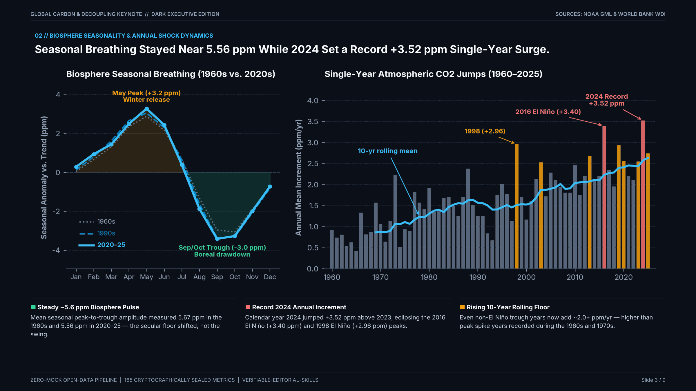
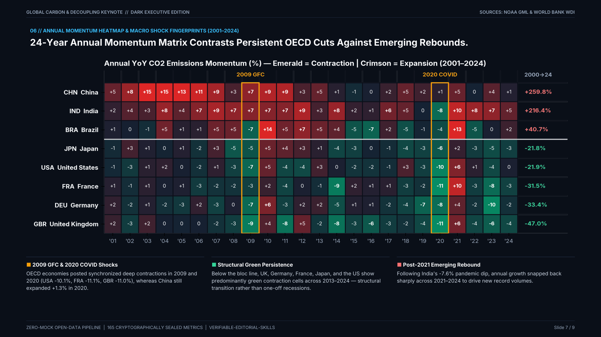

# verifiable-editorial-skills

[](https://github.com/gke0op/verifiable-editorial-skills/actions/workflows/ci.yml)

Three composable **Agent Skills** + the installable **`verifiable-editorial` (`vedit`)** verification CLI for generating institutional-grade **16:9 executive PDF slide decks**, **Letter editorial reports**, **full-bleed print photo magazines**, and **dual-target scientific monographs (PDF/UA-1 + Interactive Living Web Essays)** backed by **zero-mock, cryptographically verified open data**.

Designed for AI coding agents (**Antigravity**, **Claude Code**, **Codex**, **Cursor**) and reproducible Python pipelines (`WeasyPrint`, `ReportLab`, `Matplotlib`, `Pydantic`, `PyMuPDF`), verified on Linux CI by an **8-vector adversarial sabotage `pytest` suite**.

---

## Live Demo Outputs

All quantitative decks, scientific monographs, and reports are compiled from live zero-auth open APIs—**GBIF v1**, **iNaturalist v1**, **Open Tree of Life v3**, **NOAA Global Monitoring Laboratory** (`1958–2026`), and **World Bank WDI** (`2000–2025`)—sealed with SHA-256 hashes, validated against physical, taxonomic, and accounting invariants, registered in a 1:1 provenance ledger, verified via a Python AST anti-circular veto gate, and audited with PyMuPDF (including background-sampled WCAG 2.1 contrast and clip-aware photo coverage checks).

### Demo 1 — 10-Page Scientific Report × Learning Magazine Crossover: *BOTANICA VERIDICA* ([`demos/botanica-veridica/`](demos/botanica-veridica/))

Modeled on *Kew / Curtis’s Botanical Magazine*, DK/Kew *The Science of Plants*, *National Geographic*, and *Scientific American*: fuses **live biodiversity telemetry** (`113,962` GBIF occurrences, `11,050` museum herbarium sheets, `112,408` iNaturalist records, `720` live range-map coordinates, live flowering phenology curves, and a live OpenTree Newick phylogenetic cladogram) with **8 zero-text Nano Banana botanical plates overlaid with pure-vector SVG 90° anatomy leader lines & circular zoom medallions**. Compiles from **one verified source** into **three targets**: an interactive **PDF/UA-1** tagged monograph ([`BOTANICA_VERIDICA_MONOGRAPH.pdf`](demos/botanica-veridica/report/BOTANICA_VERIDICA_MONOGRAPH.pdf)), a **print-shop prepress** PDF with 3mm bleed & crop marks ([`BOTANICA_VERIDICA_PREPRESS.pdf`](demos/botanica-veridica/report/BOTANICA_VERIDICA_PREPRESS.pdf)), and a **zero-CDN Interactive Living Web Edition** ([`BOTANICA_VERIDICA_LIVING.html`](demos/botanica-veridica/report/BOTANICA_VERIDICA_LIVING.html)) where clicking any number opens its live SHA-256 provenance receipt. Passes all 4 `vedit` gates (`0` WCAG violations across 675 spans, `0` geometric collisions/clips/orphans, `55.9%`–`99.4%` plate coverage, `224/224` Rule 10 prose numbers grounded):

| Facing Spread 2–3 · OpenTree Phylogeny & Live GBIF World Map | Facing Spread 4–5 · *Ginkgo* SVG Anatomy & *Welwitschia* Field Split |
| :---: | :---: |
|  |  |
| **Facing Spread 6–7 · *Sequoia* Zoom Medallion & *Victoria* Truss** | **Dual-Target Interactive Living Web Edition (X-Ray SHA-256 Provenance)** |
|  |  |

### Demo 2 — 8-Page Full-Bleed Print Magazine: *FELIS MUNDI — Cats Around the World* ([`demos/felis-mundi-magazine/`](demos/felis-mundi-magazine/))

Modeled on print teardowns of *Kinfolk*, *Cereal*, *Condé Nast Traveler*, and *National Geographic*: 11 cohesive **Nano Banana** photographs generated under one locked Leica M11 / 50mm f/1.4 / Kodak Portra 400 **Master Photographic Film Identity Core**, set on warm archival `#FAF8F5` paper with `Didot` / `Charter` / `Inter`, rotated marginal credits, flush drop caps, and SHA-256 plate ledger colophon ([`FELIS_MUNDI_MAGAZINE.pdf`](demos/felis-mundi-magazine/report/FELIS_MUNDI_MAGAZINE.pdf)). Every single page is mechanically audited by exact clip-aware raster pixel-diff at **`61.1%`–`99.9%` visible full-bleed photography** (`80.6%` average):

| Full-Bleed Cover (`99.3%` Photo) | Kyoto 65/35 Split (`64.7%` Photo) | Chefchaouen Essay Plate (`99.6%` Photo) | Rome · Tokyo · Lima Triptych (`76.8%` Photo) |
| :---: | :---: | :---: | :---: |
|  |  |  |  |

### Demo 3 — 10-Slide 2023 Consulting Flagship Deck (WeasyPrint + Pure Vector SVG) ([`demos/mckinsey-2023-flagship/`](demos/mckinsey-2023-flagship/))

Engineered from visual teardowns of flagship 2023 consulting reports (*Quantum Technology Monitor*, *The Economic Potential of Generative AI*, *Global Economics Intelligence*, *The State of Organizations*): dark-midnight `#051C2C` hero & executive summary with a 42-strand parametric Bezier wave, split chapter divider, editorial serif (`Charter`/`Georgia`) + `Inter` pairing, 4-tier blue chromatic ramp, and 100% pure-vector inline SVG exhibits ([`MCKINSEY_2023_FLAGSHIP_DECK.pdf`](demos/mckinsey-2023-flagship/report/MCKINSEY_2023_FLAGSHIP_DECK.pdf)):

| Midnight Cover + Parametric Wave | Signature Mass-Balance Waterfall Bridge |
| :---: | :---: |
|  |  |
| **8-Economy Small Multiples + `»` Implications Sidebar** | **10×10 Waffle Unit-Matrix + Per-Capita Shift** |
|  |  |

### Demo 4 — 9-Slide Dual-Theme Visual Keynote (ReportLab + 300-DPI Matplotlib) ([`demos/carbon-keynote-9slide/`](demos/carbon-keynote-9slide/))

Generates **both** a Dark Executive Obsidian keynote ([`CARBON_KEYNOTE_16x9_DARK.pdf`](demos/carbon-keynote-9slide/report/CARBON_KEYNOTE_16x9_DARK.pdf)) and a Light Swiss-Ivory boardroom deck ([`CARBON_KEYNOTE_16x9_LIGHT.pdf`](demos/carbon-keynote-9slide/report/CARBON_KEYNOTE_16x9_LIGHT.pdf)) from a single `--theme dark|light` compiler across 7 distinct 300-DPI exhibits (165 verified provenance tuples):

| Swiss Ivory Cover Hero | Dark Obsidian — Biosphere & Record 2024 Surge |
| :---: | :---: |
|  |  |
| **Marimekko Pop × Per-Capita & Rank Inversion (Light)** | **24-Year Annual YoY Momentum Matrix Heatmap (Dark)** |
|  |  |

### Demo 5 — Institutional Letter Report & 6-Slide Executive Briefing ([`demos/global-carbon-telemetry/`](demos/global-carbon-telemetry/))

Paired Swiss-Ivory Letter report ([`INSTITUTIONAL_REPORT_LETTER.pdf`](demos/global-carbon-telemetry/report/INSTITUTIONAL_REPORT_LETTER.pdf)) and 6-slide Dark Executive summary deck ([`EXECUTIVE_DECK_16x9.pdf`](demos/global-carbon-telemetry/report/EXECUTIVE_DECK_16x9.pdf)):

| Cover Hero & Asymmetric Brief | Structural Bifurcation Spread | Decoupling & Few Bullet Graphs | Verified Ledger & SHA-256 Colophon |
| :---: | :---: | :---: | :---: |
|  |  |  |  |

---

## The 3-Skill Stack

| Skill | Responsibility | Included Assets |
| :--- | :--- | :--- |
| **[`verifiable-pdf-pipeline`](skills/verifiable-pdf-pipeline/SKILL.md)** | **Data integrity, contrast & anti-cheat engine.** Enforces the 9 Anti-Cheat Hard Rules (no hardcoded numbers, SHA-256 raw manifest, Pydantic bounds, 1:1 provenance ledger, Python AST linter, explicit `[N/A]` gaps, fail-closed compilation latch, Rule 9 scientific taxonomy verification, plus background-sampled WCAG 2.1 contrast and facing-spread QA). | Runnable drop-in scripts in [`templates/`](skills/verifiable-pdf-pipeline/templates/): `fetch_data.py`, `validate_reality.py`, `verify_integrity.py`, `audit_pdf.py`, `audit_contrast.py`, `render_spreads.py` |
| **[`editorial-page-layout-guidelines`](skills/editorial-page-layout-guidelines/SKILL.md)** | **Grid mathematics & visual cadence.** Defines vertical fill budgets (`85–92%` Letter, `72–88%` 16:9), asymmetric `310 pt / 180 pt` spreads, Letter & widescreen slide archetypes, 6 full-bleed photo magazine archetypes (`M1–M6`), and 4 scientific report × magazine crossover archetypes (`S1–S4`). | Full grid formulas, token tables, & micro-typography guardrails |
| **[`premium-pdf-design`](skills/premium-pdf-design/SKILL.md)** | **Visual system & WeasyPrint/ReportLab execution.** 60-30-10 palettes, consulting flagship vector SVGs, cohesive Nano Banana stock photography recipes, hybrid zero-text plate + SVG 90° anatomy overlays, interactive PDF/UA-1 bookmarks/links, and `--prepress` 3mm bleed + crop marks. | [`references/design_laws_and_lexicon.md`](skills/premium-pdf-design/references/design_laws_and_lexicon.md), [`references/image_generation_recipes.md`](skills/premium-pdf-design/references/image_generation_recipes.md), [`examples/reportlab_premium_template.py`](skills/premium-pdf-design/examples/reportlab_premium_template.py) |

---

## The 10 Anti-Cheat Rules Enforced in Code

1. **Zero-Handwritten-Data Air-Gap:** No manual numeric dictionaries, CSVs, or JSONs—every value is parsed by code from immutable files in `data/raw/`.
2. **Reality & Invariant Compiler:** Pydantic v2 enforces domain physics bounds and exact accounting identities (e.g., `CO2_total * 1e6 / population == CO2_per_capita` within machine tolerance).
3. **Anti-Circular Verification (AST Linter):** `verify_integrity.py` parses verifier code with Python `ast` and rejects assertions comparing domain values against hardcoded numeric literals.
4. **Atomic Provenance Ledger:** Every scalar in `data/summary_metrics.json` maps 1:1 to a record in `data/provenance_ledger.json` citing source document, locator, exact extracted quote, and live file SHA-256.
5. **Negative Capability & The Sacred `[N/A]`:** Genuinely unreported upstream fields (such as 2025 CO2 emissions, WDI renewables gaps, or `NOT_EVALUATED` IUCN categories) remain explicit `null` / `[N/A]` rather than fabricated extrapolations.
6. **Substance Precedence (Compilation Latch):** PDF and Living Web compilers refuse to execute unless `verify_integrity.py` exits `0`.
7. **Category & Unit Incommensurability Guard:** Distinct metrics, scopes, or test standards are never silently blended.
8. **Primary Regulatory & Statutory Proof:** Legal or tariff claims require official statutory identifiers and explicit scope.
9. **Scientific Taxonomy & Registry Verification:** Every biological binomial, authority, Family, Order, phylogenetic node, and IUCN code is reconciled verbatim from live authoritative registries (**GBIF Backbone**, **Open Tree of Life**, **iNaturalist**).
10. **Post-Render Prose-to-Ledger Grounding (`vedit prose`):** Extracts every quantitative number directly from the final compiled PDF bytes and verifies 100% grounding against `provenance_ledger.json`, `summary_metrics.json`, or explicit DOI-backed entries in `background_citations.json`.

---

## Install the Skills & `vedit` Verification CLI

```bash
git clone https://github.com/gke0op/verifiable-editorial-skills.git
cd verifiable-editorial-skills

# Install the `vedit` verification CLI + adversarial pytest suite
pip install -e ".[dev]"
pytest

# Install the 3 Agent Skills (Antigravity / Claude Code / Codex / Cursor)
cp -r skills/* ~/.gemini/config/skills/   # Antigravity
cp -r skills/* ~/.claude/skills/          # Claude Code
```

### Run the Unified `vedit` Audit Court on Any PDF

```bash
# Run WCAG 2.1 contrast + geometric collision/clipping/orphan + photo coverage + Rule 10 prose grounding
vedit audit-all demos/botanica-veridica/report/BOTANICA_VERIDICA_MONOGRAPH.pdf \
  --ledger demos/botanica-veridica/data/provenance_ledger.json \
  --summary demos/botanica-veridica/data/summary_metrics.json \
  --citations demos/botanica-veridica/data/background_citations.json \
  --manifest demos/botanica-veridica/data/manifest.sha256 \
  --plate-pages "1,4-9"

# Individual gates & facing-spread contact sheet renderer:
vedit contrast path/to/deck.pdf
vedit geometry path/to/deck.pdf
vedit coverage path/to/magazine.pdf --min-pct 50
vedit spreads path/to/magazine.pdf --out-dir /tmp/spreads
```

---

## Reproduce the Live Demos Locally

```bash
pip install -r requirements.txt

# Optional: point INTER_FONT_DIR to a folder containing Inter-*.ttf
# (Falls back cleanly to Helvetica if omitted)
export INTER_FONT_DIR=/path/to/inter/ttf

bash demos/botanica-veridica/run_pipeline.sh
bash demos/felis-mundi-magazine/run_pipeline.sh
bash demos/mckinsey-2023-flagship/run_pipeline.sh
bash demos/carbon-keynote-9slide/run_pipeline.sh
bash demos/global-carbon-telemetry/run_pipeline.sh

# Run the standalone drop-in WCAG contrast auditor or facing-spread renderer on any PDF:
python3 skills/verifiable-pdf-pipeline/templates/audit_contrast.py demos/botanica-veridica/report/BOTANICA_VERIDICA_MONOGRAPH.pdf
python3 skills/verifiable-pdf-pipeline/templates/render_spreads.py demos/botanica-veridica/report/BOTANICA_VERIDICA_MONOGRAPH.pdf --out-dir /tmp/spreads
```

To test the standalone starter template in both dark 16:9 and light Letter modes:

```bash
python3 skills/premium-pdf-design/examples/reportlab_premium_template.py \
  --mode dark --format 16x9 --out /tmp/starter_dark_16x9.pdf

python3 skills/premium-pdf-design/examples/reportlab_premium_template.py \
  --mode light --format letter --out /tmp/starter_light_letter.pdf
```

---

## License

Code, skill definitions, and templates are licensed under the [MIT License](LICENSE). Demo open datasets retain their respective upstream attributions (GBIF — CC0/CC BY; iNaturalist — CC0/CC BY; Open Tree of Life — CC0; NOAA Global Monitoring Laboratory — Public Domain; World Bank Open Data WDI — CC BY-4.0).
