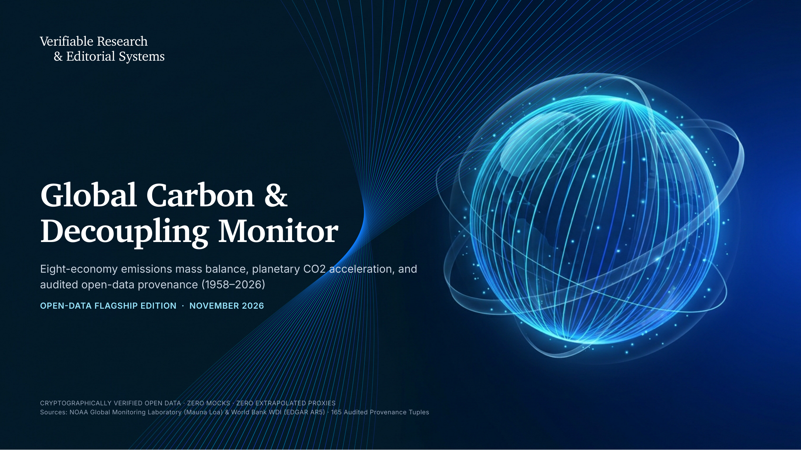
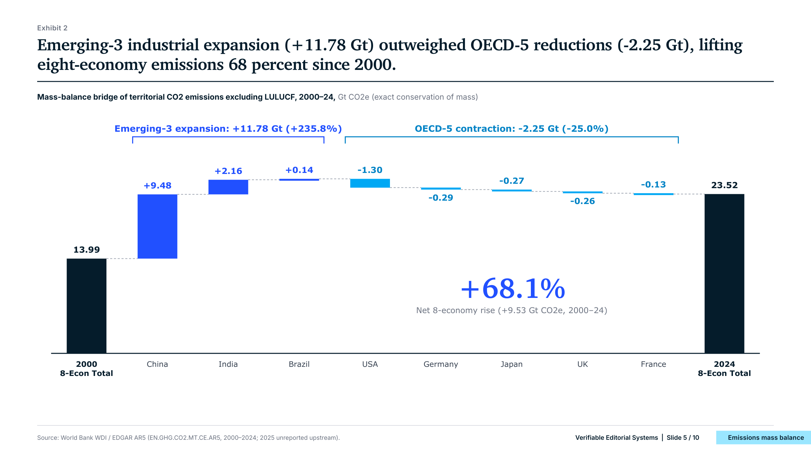
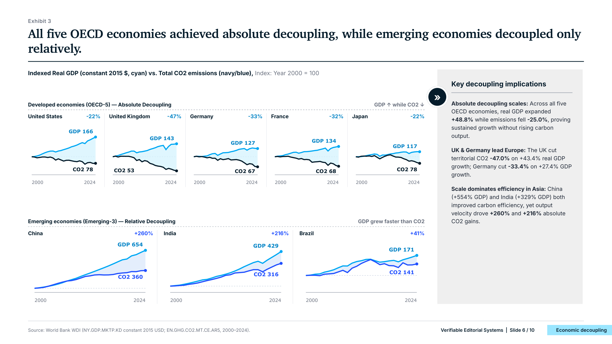
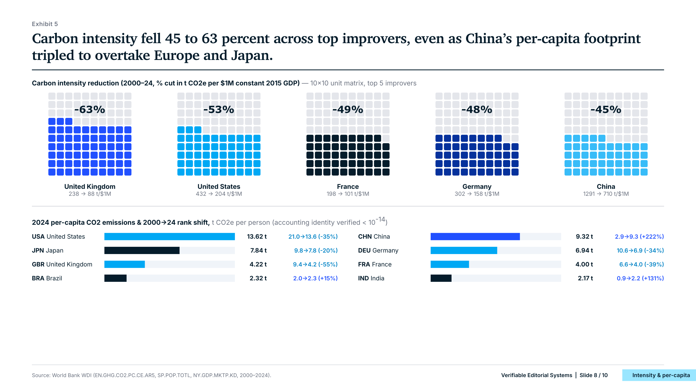
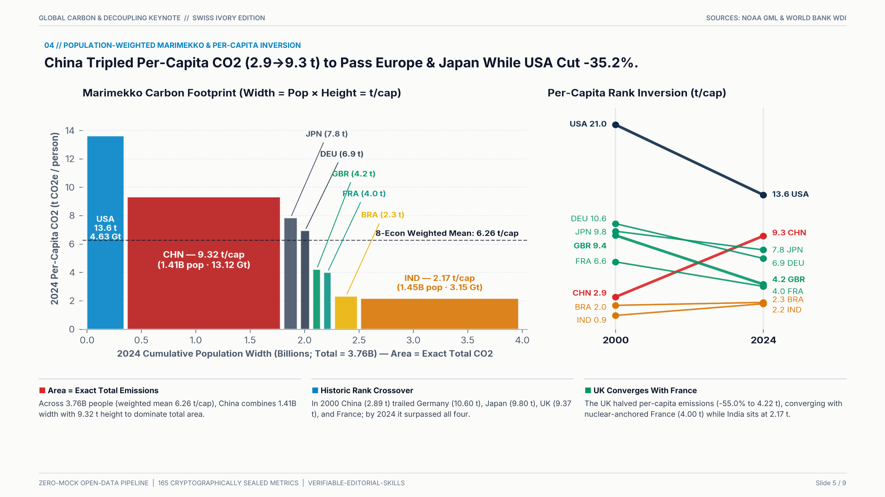
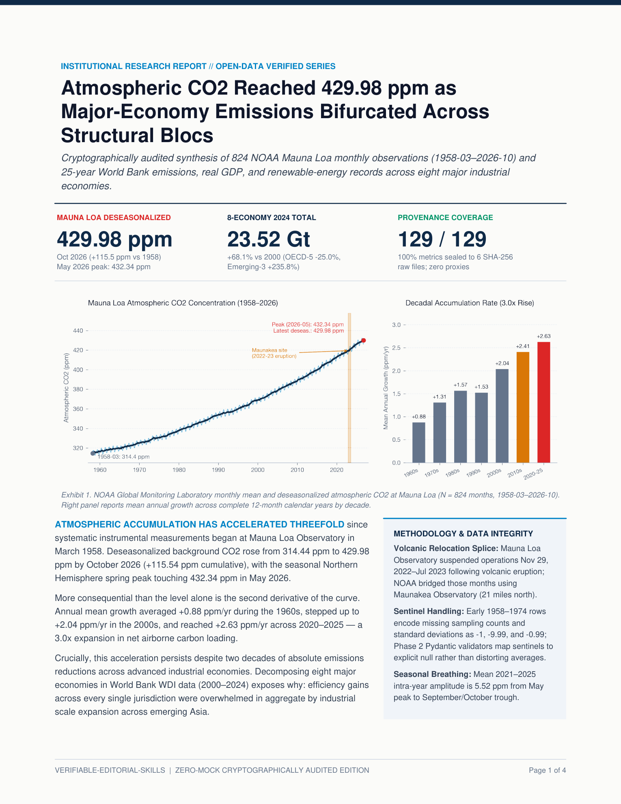

# verifiable-editorial-skills

Three composable **Agent Skills** for generating institutional-grade **16:9 executive PDF slide decks** and **Letter editorial reports** backed by **zero-mock, cryptographically verified open data**.

Designed for AI coding agents (**Antigravity**, **Claude Code**, **Codex**, **Cursor**) and reproducible Python pipelines (`ReportLab`, `Matplotlib`, `Pydantic`, `PyMuPDF`).

---

## Live Demo Outputs (100% Real Public Data — Zero Mocks)

All showcase decks and reports are compiled from live **NOAA Global Monitoring Laboratory** (`1958–2026`, 824 monthly observations) and **World Bank WDI** (`2000–2025`, 8 major economies) datasets—sealed with SHA-256 hashes, validated against physical & exact accounting identities, registered in an atomic provenance ledger, verified via a Python AST anti-circular veto gate, and audited with PyMuPDF.

### Demo 1 — 10-Slide 2023 Consulting Flagship Deck (WeasyPrint + Pure Vector SVG) ([`demos/mckinsey-2023-flagship/`](demos/mckinsey-2023-flagship/))

Engineered from visual teardowns of flagship 2023 consulting reports (*Quantum Technology Monitor*, *The Economic Potential of Generative AI*, *Global Economics Intelligence*, *The State of Organizations*): dark-midnight `#051C2C` hero & executive summary with a 42-strand parametric Bezier wave, split chapter divider, editorial serif (`Charter`/`Georgia`) + `Inter` pairing, 4-tier blue chromatic ramp, and 100% pure-vector inline SVG exhibits ([`MCKINSEY_2023_FLAGSHIP_DECK.pdf`](demos/mckinsey-2023-flagship/report/MCKINSEY_2023_FLAGSHIP_DECK.pdf)):

| Midnight Cover + Parametric Wave | Signature Mass-Balance Waterfall Bridge |
| :---: | :---: |
|  |  |
| **8-Economy Small Multiples + `»` Implications Sidebar** | **10×10 Waffle Unit-Matrix + Per-Capita Shift** |
|  |  |

### Demo 2 — 9-Slide Dual-Theme Visual Keynote (ReportLab + 300-DPI Matplotlib) ([`demos/carbon-keynote-9slide/`](demos/carbon-keynote-9slide/))

Generates **both** a Dark Executive Obsidian keynote ([`CARBON_KEYNOTE_16x9_DARK.pdf`](demos/carbon-keynote-9slide/report/CARBON_KEYNOTE_16x9_DARK.pdf)) and a Light Swiss-Ivory boardroom deck ([`CARBON_KEYNOTE_16x9_LIGHT.pdf`](demos/carbon-keynote-9slide/report/CARBON_KEYNOTE_16x9_LIGHT.pdf)) from a single `--theme dark|light` compiler across 7 distinct 300-DPI exhibits (165 verified provenance tuples):

| Swiss Ivory Cover Hero | Dark Obsidian — Biosphere & Record 2024 Surge |
| :---: | :---: |
|  |  |
| **Marimekko Pop × Per-Capita & Rank Inversion (Light)** | **24-Year Annual YoY Momentum Matrix Heatmap (Dark)** |
|  |  |

### Demo 3 — Institutional Letter Report & 6-Slide Executive Briefing ([`demos/global-carbon-telemetry/`](demos/global-carbon-telemetry/))

Paired Swiss-Ivory Letter report ([`INSTITUTIONAL_REPORT_LETTER.pdf`](demos/global-carbon-telemetry/report/INSTITUTIONAL_REPORT_LETTER.pdf)) and 6-slide Dark Executive summary deck ([`EXECUTIVE_DECK_16x9.pdf`](demos/global-carbon-telemetry/report/EXECUTIVE_DECK_16x9.pdf)):

| Cover Hero & Asymmetric Brief | Structural Bifurcation Spread | Decoupling & Few Bullet Graphs | Verified Ledger & SHA-256 Colophon |
| :---: | :---: | :---: | :---: |
|  |  |  |  |

---

## The 3-Skill Stack

| Skill | Responsibility | Included Assets |
| :--- | :--- | :--- |
| **[`verifiable-pdf-pipeline`](skills/verifiable-pdf-pipeline/SKILL.md)** | **Data integrity & anti-cheat engine.** Enforces the 8 Anti-Cheat Hard Rules (no hardcoded numbers, SHA-256 raw manifest, Pydantic bounds, 1:1 provenance ledger, Python AST linter banning literal assertions, explicit `[N/A]` gaps, fail-closed compilation latch). | Runnable drop-in scripts in [`templates/`](skills/verifiable-pdf-pipeline/templates/): `fetch_data.py`, `validate_reality.py`, `verify_integrity.py`, `audit_pdf.py` |
| **[`editorial-page-layout-guidelines`](skills/editorial-page-layout-guidelines/SKILL.md)** | **Grid mathematics & visual cadence.** Defines vertical fill budgets (`85–92%` Letter, `72–88%` 16:9), asymmetric `310 pt / 180 pt` spreads, 5 Letter archetypes, 4 widescreen slide archetypes, Inter typographic scale, and hairline scaffolding (zero boxed dashboard cards). | Full grid formulas, token tables, & micro-typography guardrails |
| **[`premium-pdf-design`](skills/premium-pdf-design/SKILL.md)** | **Visual system & ReportLab/Matplotlib execution.** 60-30-10 light/dark palettes, full-bleed canvas painting, safe Inter TTF registration with Helvetica fallback, Minto Pyramid action titles, and 6 institutional chart recipes (Keeling/rate, stacked mass balance, decoupling quadrants, Stephen Few bullet graphs, inline sparklines). | [`references/design_laws_and_lexicon.md`](skills/premium-pdf-design/references/design_laws_and_lexicon.md), [`references/image_generation_recipes.md`](skills/premium-pdf-design/references/image_generation_recipes.md), [`examples/reportlab_premium_template.py`](skills/premium-pdf-design/examples/reportlab_premium_template.py) |

---

## The 8 Anti-Cheat Rules Enforced in Code

1. **Zero-Handwritten-Data Air-Gap:** No manual numeric dictionaries, CSVs, or JSONs—every value is parsed by code from immutable files in `data/raw/`.
2. **Reality & Invariant Compiler:** Pydantic v2 enforces domain physics bounds and exact accounting identities (e.g., `CO2_total * 1e6 / population == CO2_per_capita` within machine tolerance).
3. **Anti-Circular Verification (AST Linter):** `verify_integrity.py` parses verifier code with Python `ast` and rejects assertions comparing domain values against hardcoded numeric literals.
4. **Atomic Provenance Ledger:** Every scalar in `data/summary_metrics.json` maps 1:1 to a record in `data/provenance_ledger.json` citing source document, locator, exact extracted quote, and live file SHA-256.
5. **Negative Capability & The Sacred `[N/A]`:** Genuinely unreported upstream fields (such as 2025 CO2 emissions and 2022–2025 WDI renewables shares in the demo) remain explicit `null` / `[N/A]` rather than fabricated extrapolations.
6. **Substance Precedence (Compilation Latch):** PDF compilers refuse to execute unless `verify_integrity.py` exits `0`.
7. **Category & Unit Incommensurability Guard:** Distinct metrics, scopes, or test standards are never silently blended.
8. **Primary Regulatory & Statutory Proof:** Legal or tariff claims require official statutory identifiers and explicit scope.

---

## Install the Skills

Copy the three skill folders into your agent's skills directory:

```bash
git clone https://github.com/gke0op/verifiable-editorial-skills.git

# Antigravity
cp -r verifiable-editorial-skills/skills/* ~/.gemini/config/skills/

# Claude Code (or adapt to ~/.codex/skills / .cursor/skills)
cp -r verifiable-editorial-skills/skills/* ~/.claude/skills/
```

---

## Reproduce the Live Demos Locally

```bash
pip install -r requirements.txt

# Optional: point INTER_FONT_DIR to a folder containing Inter-*.ttf
# (Falls back cleanly to Helvetica if omitted)
export INTER_FONT_DIR=/path/to/inter/ttf

bash demos/mckinsey-2023-flagship/run_pipeline.sh
bash demos/carbon-keynote-9slide/run_pipeline.sh
bash demos/global-carbon-telemetry/run_pipeline.sh
```

To test the standalone starter template in both dark 16:9 and light Letter modes:

```bash
python3 skills/premium-pdf-design/examples/reportlab_premium_template.py \
  --mode dark --format 16x9 --out /tmp/starter_dark_16x9.pdf

python3 skills/premium-pdf-design/examples/reportlab_premium_template.py \
  --mode light --format letter --out /tmp/starter_light_letter.pdf
```

---

## License

Code, skill definitions, and templates are licensed under the [MIT License](LICENSE). Demo open datasets retain their respective upstream attributions (NOAA Global Monitoring Laboratory — Public Domain; World Bank Open Data WDI — CC BY-4.0).
