# verifiable-editorial-skills

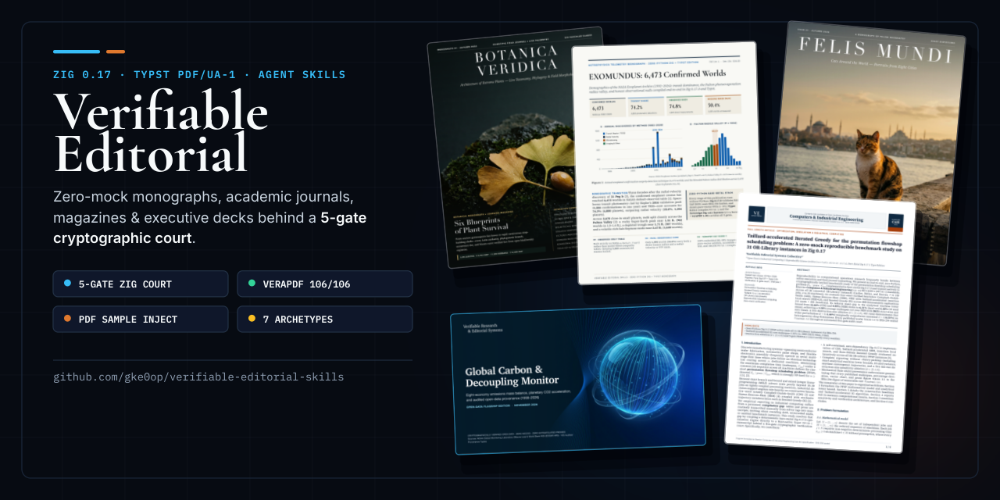

[](https://github.com/gke0op/verifiable-editorial-skills/actions/workflows/ci.yml)
[](https://github.com/gke0op/verifiable-editorial-skills/releases/latest)

Editorial PDF generation and post-render verification for AI agents — built with Zig, Typst, and three composable skills.

Documents compile directly from sealed raw data and are checked after rendering for data provenance, contrast, layout geometry, print and accessibility compliance, and live links. Feed any reference PDF to `vedit inject` to capture its design system as a reusable archetype.

---

## Gallery

### Cosmos in Your Pocket
9:16 mobile field primer on cosmic scales · [PDF](demos/cosmos-mobile-primer/report/COSMOS_MOBILE_PRIMER_UA1.pdf) · [Source](demos/cosmos-mobile-primer/)

| Cover | Mass & Horizons | Neutron Star | Black Hole |
| :---: | :---: | :---: | :---: |
|  | 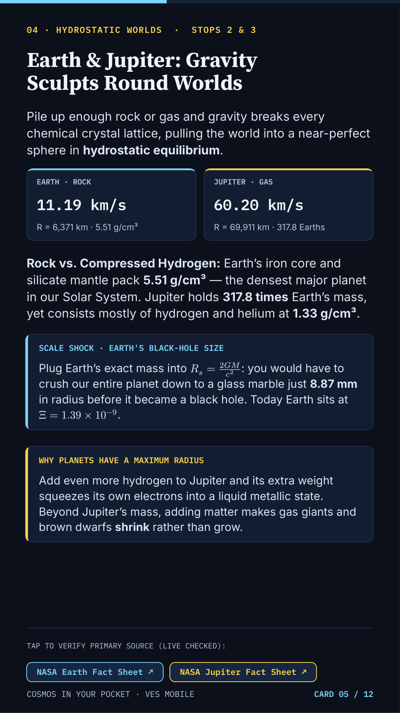 | 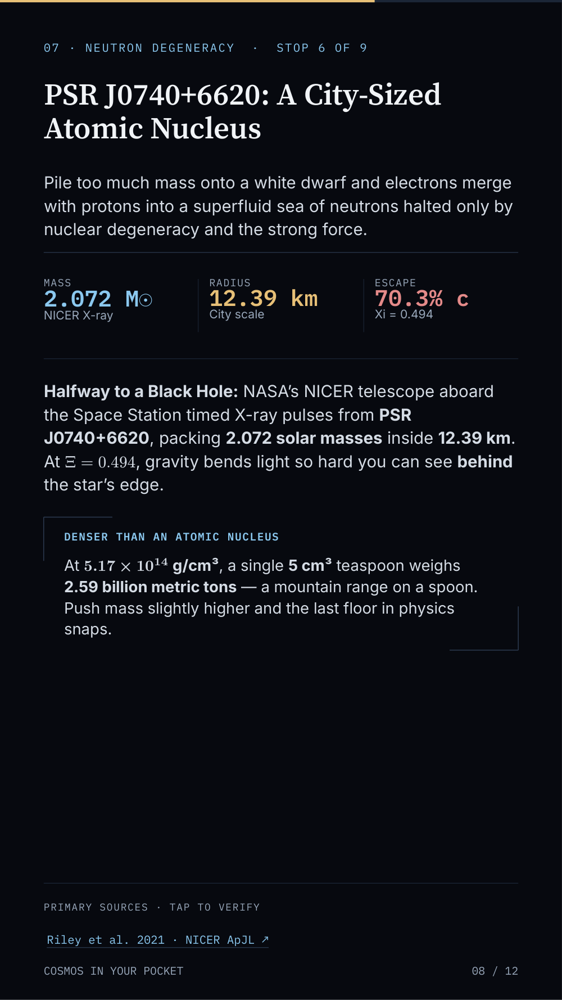 | 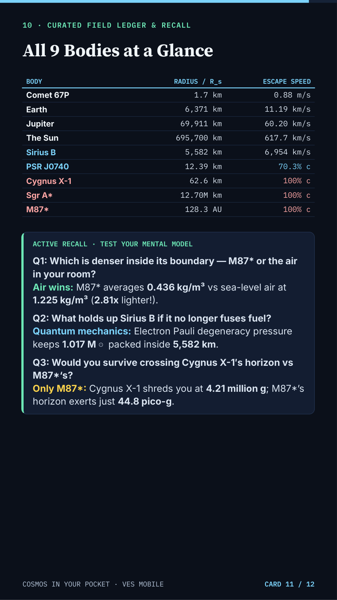 |

---

### Physical Review Letters
Two-column physics letter (`APS REVTeX 4.2`) · [PDF](demos/prl-yang-mills-chaos/report/PRL_YANG_MILLS_CHAOS_UA1.pdf) · [Source](demos/prl-yang-mills-chaos/)

| Masthead & Equations | Poincaré Sections & Widetext | Table I & References |
| :---: | :---: | :---: |
| 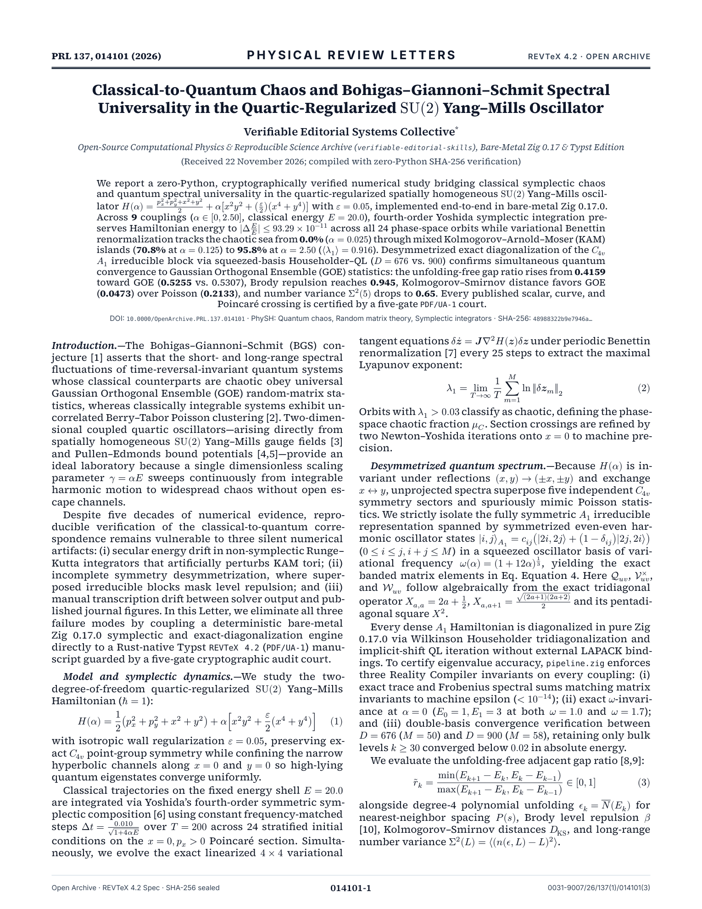 |  | 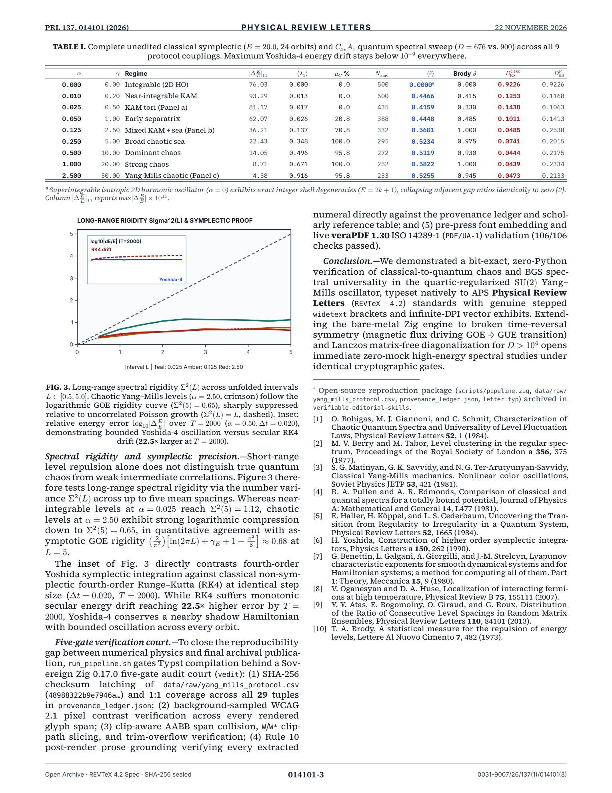 |

---

### Computers & Industrial Engineering
Operations research manuscript (`Elsevier cas-dc`) · [PDF](demos/caie-flowshop-journal/report/CAIE_FLOWSHOP_MANUSCRIPT_UA1.pdf) · [Source](demos/caie-flowshop-journal/)

| Abstract & Highlights | Model & Algorithm | Benchmark Table | Gantt & References |
| :---: | :---: | :---: | :---: |
|  | 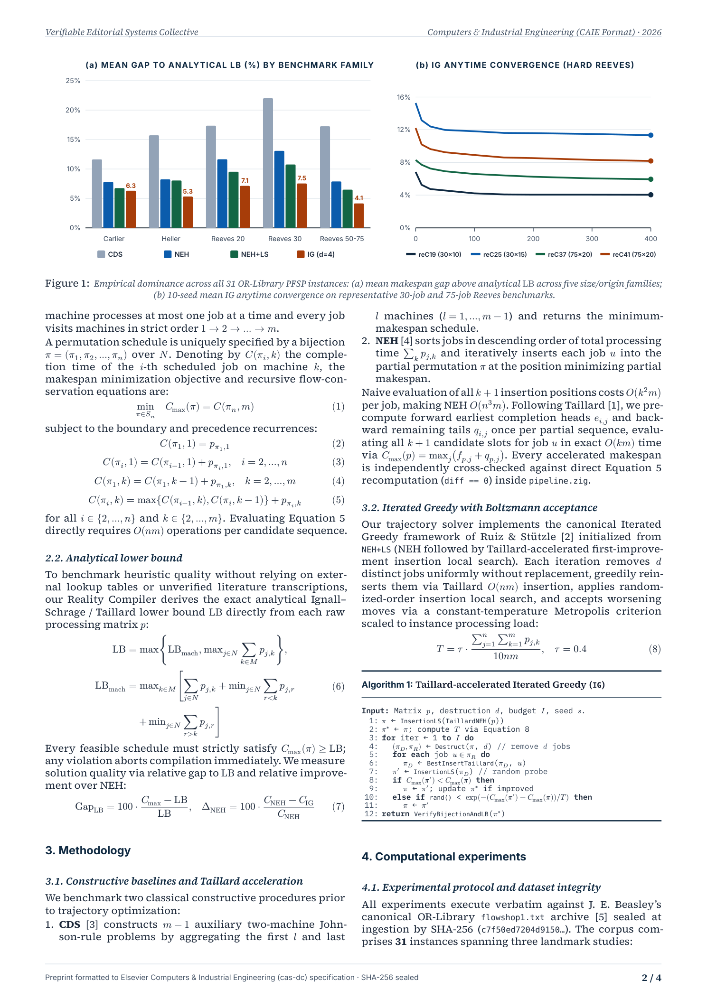 | 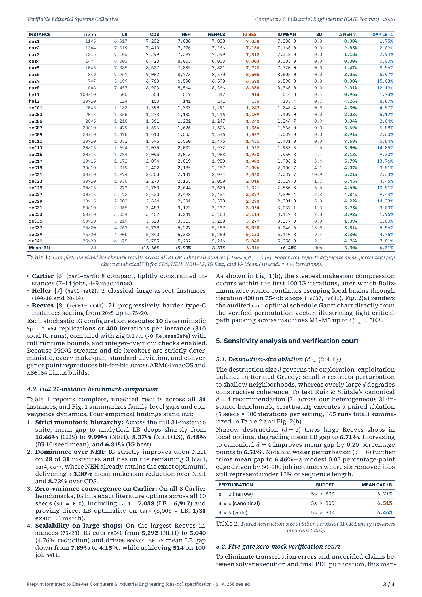 |  |

---

### EXOMUNDUS
NASA Exoplanet Archive census · [PDF](demos/exomundus-nasa-telemetry/report/EXOMUNDUS_NASA_TELEMETRY_UA1.pdf) · [Source](demos/exomundus-nasa-telemetry/)

| Radius Valley | Mass–Radius | Scaling Laws | Provenance |
| :---: | :---: | :---: | :---: |
|  |  |  |  |

---

### BOTANICA VERIDICA
Natural-history monograph, print bleed, and interactive web edition · [PDF](demos/botanica-veridica/report/BOTANICA_VERIDICA_MONOGRAPH.pdf) · [Prepress](demos/botanica-veridica/report/BOTANICA_VERIDICA_PREPRESS.pdf) · [Living Web](demos/botanica-veridica/report/BOTANICA_VERIDICA_LIVING.html) · [Source](demos/botanica-veridica/)

| Cladogram & Distribution Map | *Ginkgo* & *Welwitschia* |
| :---: | :---: |
|  | 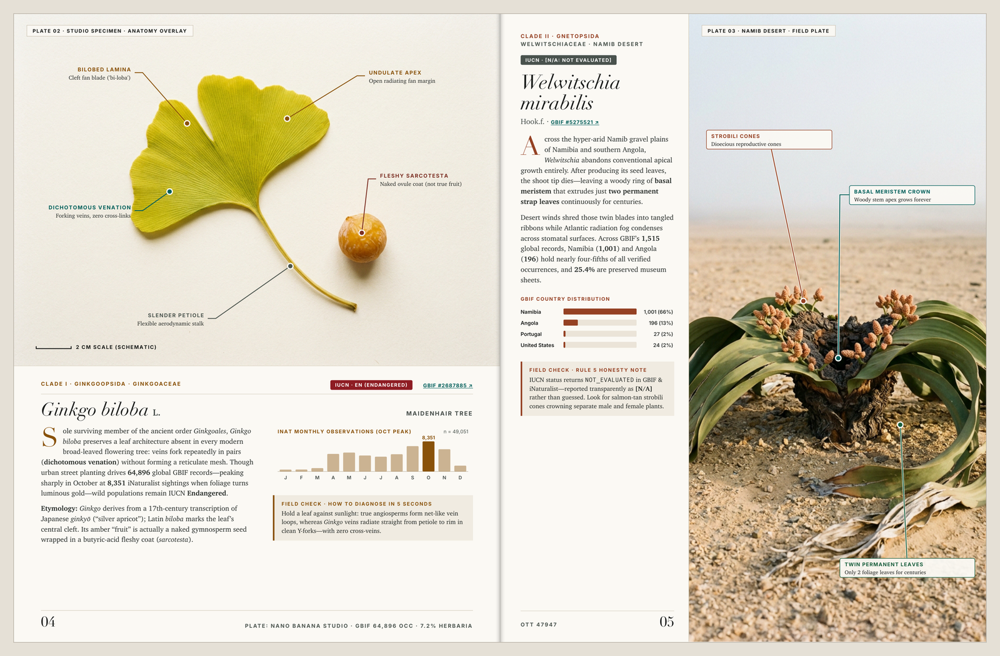 |
| ***Sequoia* & *Victoria*** | **Living Web Edition** |
|  |  |

---

### Global Carbon Telemetry
NOAA and World Bank scientific monograph · [PDF](demos/typst-carbon-monograph/report/TYPST_CARBON_MONOGRAPH_UA1.pdf) · [Source](demos/typst-carbon-monograph/)

| Keeling Curve | Bloc Divergence | Model & Audit | Provenance |
| :---: | :---: | :---: | :---: |
|  |  |  | 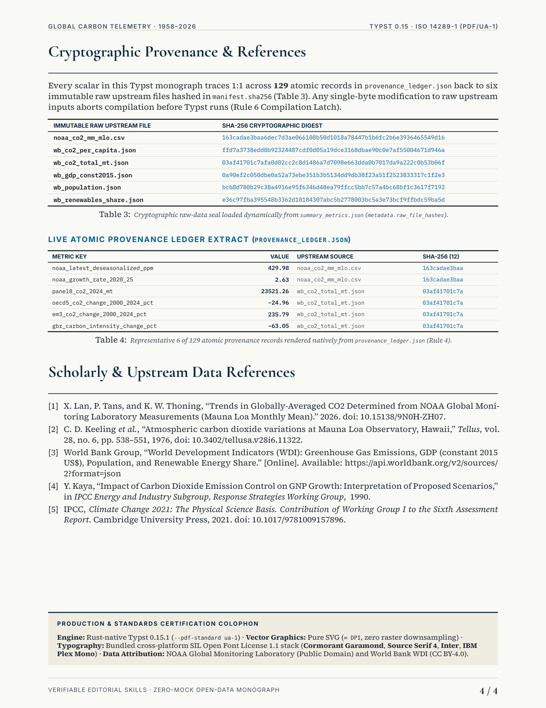 |

---

### FELIS MUNDI
Full-bleed editorial photojournalism · [PDF](demos/felis-mundi-magazine/report/FELIS_MUNDI_MAGAZINE.pdf) · [Source](demos/felis-mundi-magazine/)

| Cover | Kyoto | Chefchaouen | Triptych |
| :---: | :---: | :---: | :---: |
|  |  |  |  |

---

### Executive Decks & Reports
Consulting and dual-theme 16:9 keynotes · [Consulting](demos/consulting-flagship/report/CONSULTING_FLAGSHIP_DECK.pdf) · [Dark Keynote](demos/carbon-keynote-9slide/report/CARBON_KEYNOTE_16x9_DARK.pdf) · [Light Keynote](demos/carbon-keynote-9slide/report/CARBON_KEYNOTE_16x9_LIGHT.pdf) · [Letter Report](demos/global-carbon-telemetry/report/INSTITUTIONAL_REPORT_LETTER.pdf)

| Midnight Hero | Waterfall Bridge |
| :---: | :---: |
| 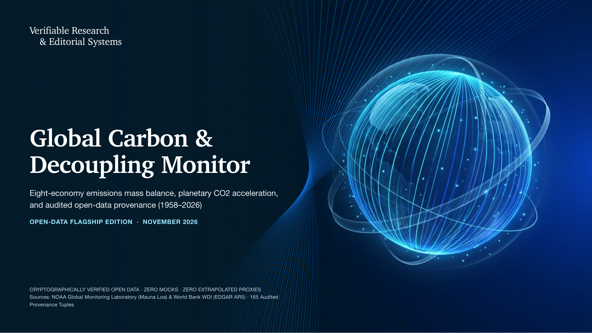 |  |
| **Dark Obsidian** | **Swiss Ivory** |
|  |  |

---

## Quick Start

### Install `vedit`

```bash
# Pre-built binary for macOS (arm64) and Linux (x86_64, aarch64)
curl -fsSL https://raw.githubusercontent.com/gke0op/verifiable-editorial-skills/main/install.sh | sh

# Runtime companions: mupdf-tools (mutool), Typst, and optional veraPDF
# macOS: brew install mupdf-tools typst   |   Ubuntu: sudo apt install mupdf-tools
vedit fetch-fonts
```

### Install Agent Skills

```bash
git clone https://github.com/gke0op/verifiable-editorial-skills.git
cd verifiable-editorial-skills

cp -r skills/* ~/.gemini/config/skills/   # Antigravity
cp -r skills/* ~/.claude/skills/          # Claude Code
```

### Usage

```bash
# Dissect any reference PDF into a reusable archetype
vedit inject path/to/sample.pdf --name my-style

# Scaffold a new Typst project from an archetype
vedit init ./new-report --archetype mobile-primer --title "Field Primer"

# Prepare a seamless editorial plate or facing-spread preview
vedit plate raw.jpg plate.jpg --width-pt 304 --height-pt 118 --bg "#07090F"
vedit spreads report.pdf previews/spreads

# Audit any compiled PDF end-to-end
vedit audit-all report.pdf --ledger data/provenance_ledger.json --manifest data/manifest.sha256 --require-ua --verify-links
```

---

## What `vedit` Verifies

- **Data latch** (`vedit latch`) — verifies raw file digests and metric provenance before build.
- **Contrast** (`vedit contrast`) — checks rendered foreground text against actual composited backgrounds.
- **Geometry & photography** (`vedit geometry`, `vedit coverage`) — catches overlapping text, clipped glyphs, trim overflows, orphans, and insufficient photo coverage.
- **Prose grounding** (`vedit prose`) — reconciles numbers in the rendered PDF back to verified data.
- **Pre-press & accessibility** (`vedit prepress`) — checks image DPI, embedded fonts, bleed boxes, ink limits, and PDF/UA-1 compliance.
- **Resource links** (`vedit links`) — ensures citations are clickable PDF annotations and resolve live.

Full CLI reference, architecture, and test court details live in [`zig/README.md`](zig/README.md), [`archetypes/README.md`](archetypes/README.md), [`skills/`](skills/verifiable-pdf-pipeline/SKILL.md), and [`tests/README.md`](tests/README.md).

## Repository

```
zig/          Standalone Zig 0.17 CLI (vedit), media tools, dissector, and test court
skills/       Composable agent skills for editorial design, layout, and verification
archetypes/   Nine dissected PDF design systems (mobile, journals, monographs, decks, magazines)
demos/        Live Typst publications and archival visual showcases
install.sh    SHA-256 verified binary installer
```

Build and test from source with Zig 0.17:

```bash
cd zig && zig build test && zig build test-court
```

## License

MIT ([LICENSE](LICENSE)). Demo datasets retain upstream attributions (OR-Library, NASA Exoplanet Archive, NOAA GML, World Bank WDI, GBIF, iNaturalist, Open Tree of Life).
