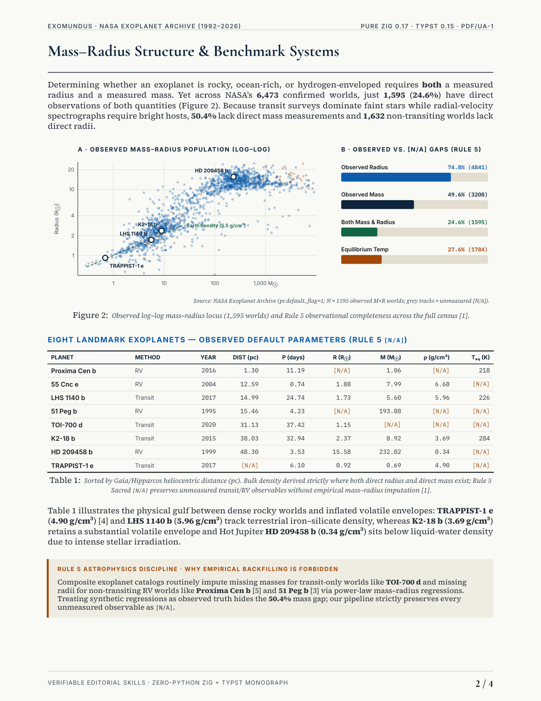
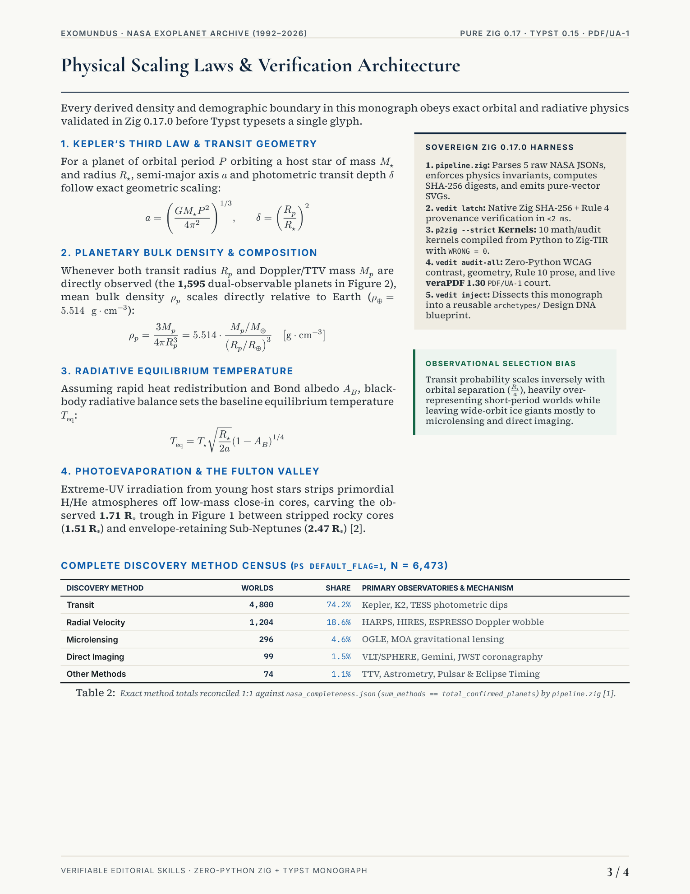
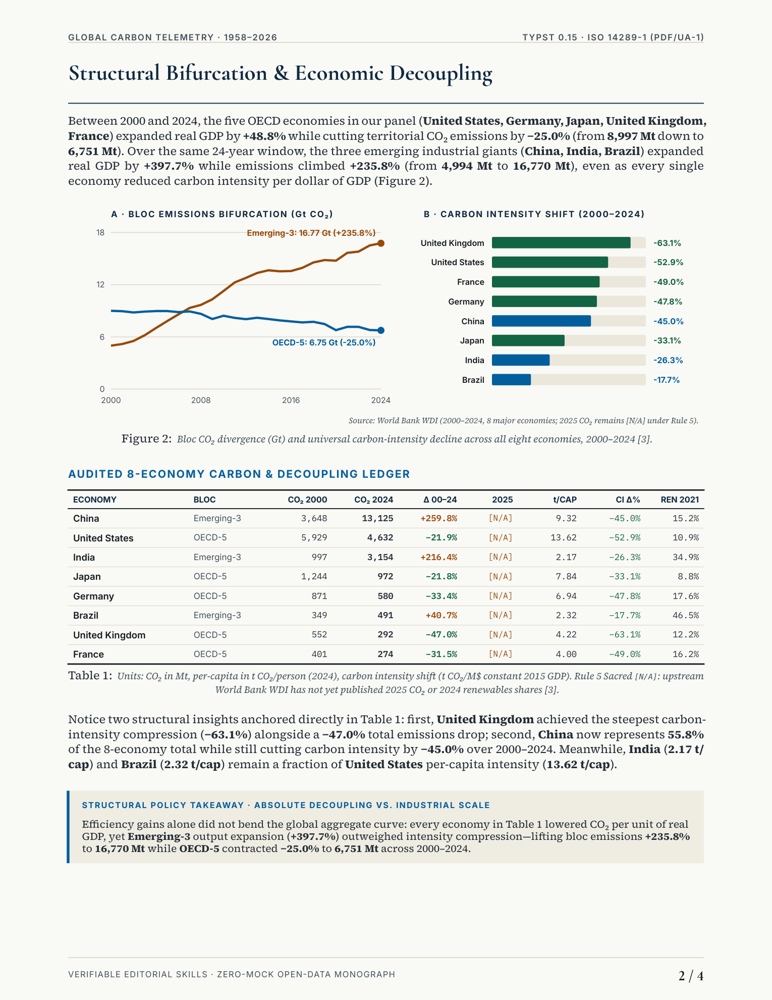
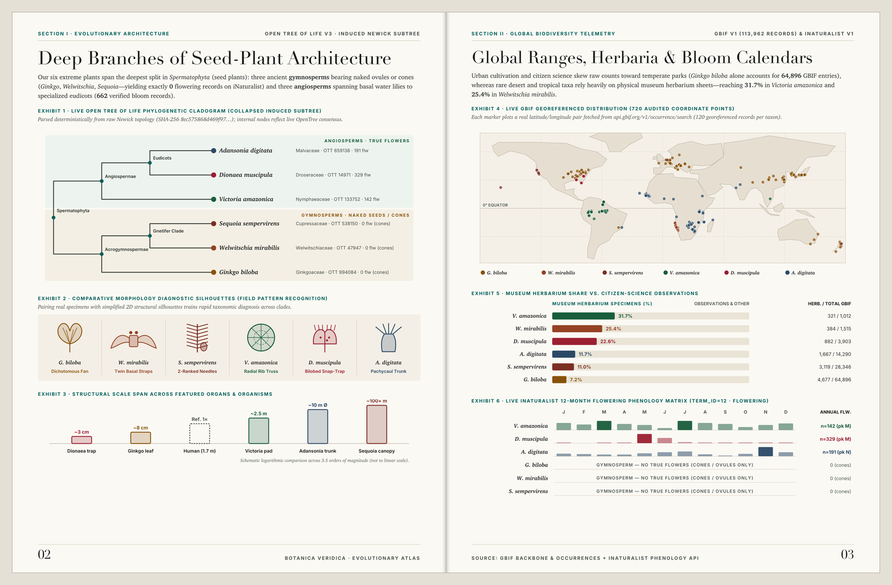
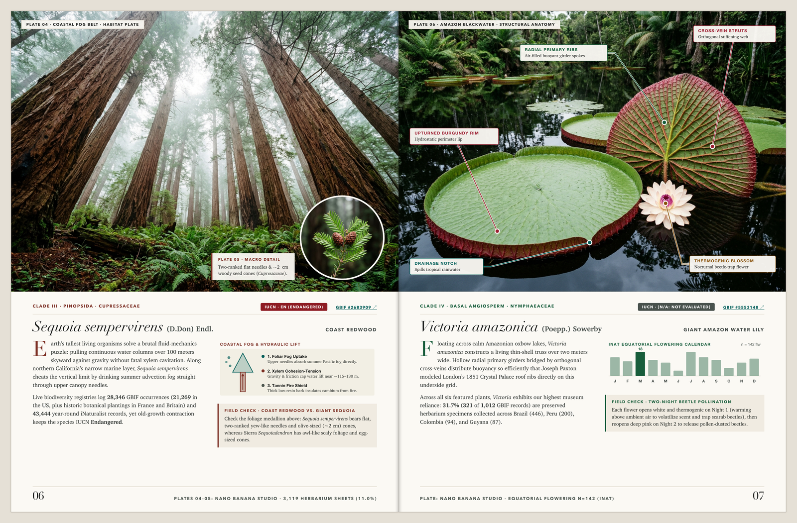
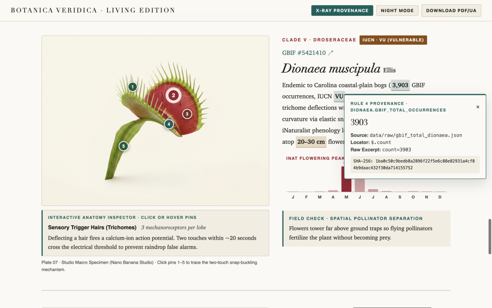
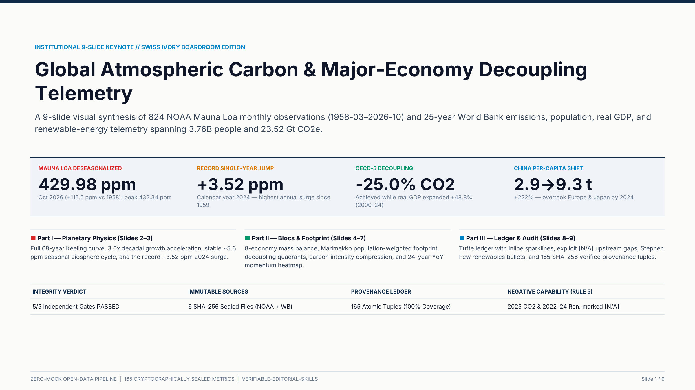
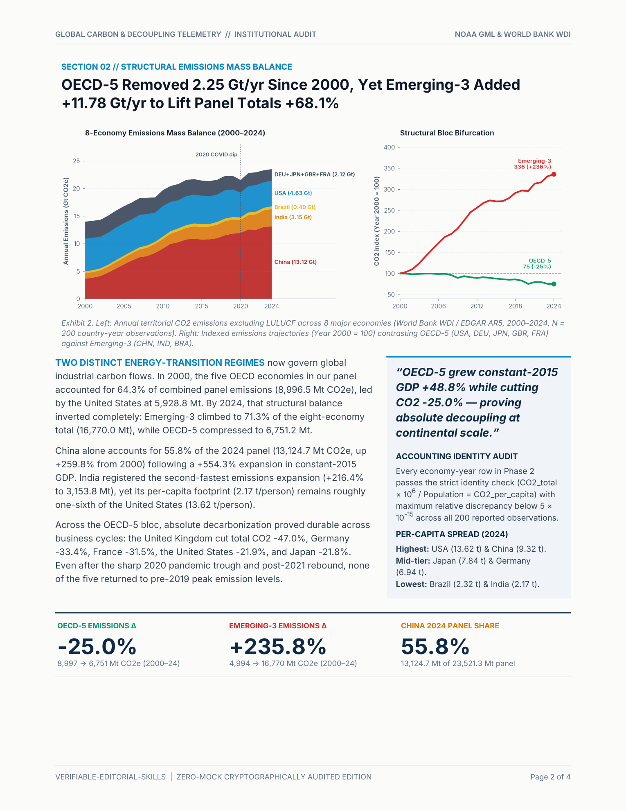
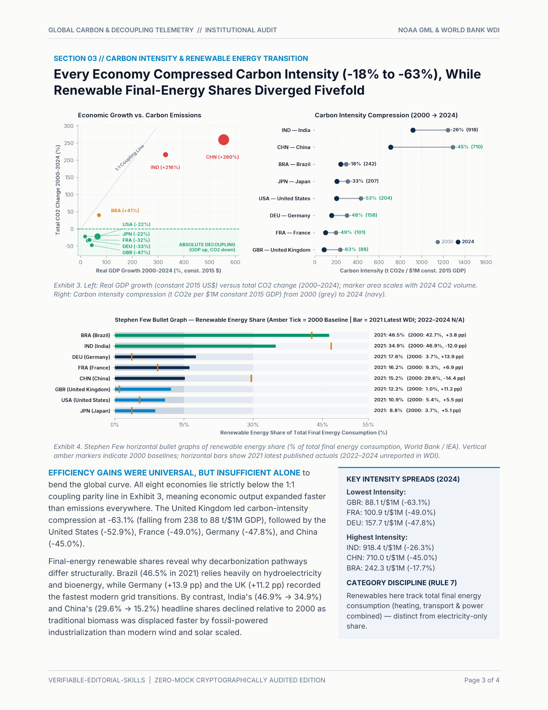
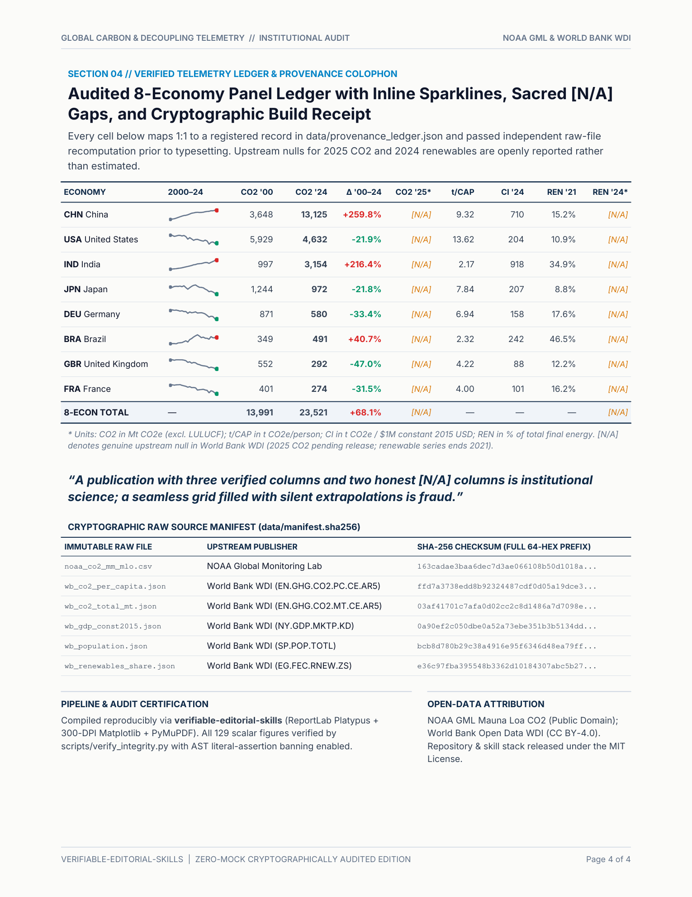

# verifiable-editorial-skills

[](https://github.com/gke0op/verifiable-editorial-skills/actions/workflows/ci.yml)

Three composable **Agent Skills** + the **Sovereign Zig 0.17.0 Agent Harness (`zig/zig-out/bin/vedit`)** (powered by `p2zig --strict` transpiled kernels) + Python `vedit` CLI for generating institutional-grade **Rust-native Typst `PDF/UA-1` monographs**, **16:9 executive PDF slide decks**, **Letter editorial reports**, **full-bleed print photo magazines**, and **dual-target scientific monographs**—plus **one-command PDF Sample Dissection & Archetype Injection (`vedit inject` → `vedit init`)** so agents can dissect *any* external reference PDF into reusable Design DNA.

Designed for AI coding agents (**Antigravity**, **Claude Code**, **Codex**, **Cursor**) and reproducible multi-backend pipelines (**Zig 0.17.0**, **Typst 0.15.1**, `MuPDF`, **`veraPDF`**, `WeasyPrint`, `ReportLab`, `Pydantic`), verified live on Ubuntu Linux CI by a **20-test adversarial sabotage, `p2zig` parity, and closed-loop synthesis `pytest` suite** plus native `zig build test` (`Debug` & `--release=safe`).

---

## Sovereign Zig 0.17.0 Agent Harness & PDF Dissector (`zig/` + `archetypes/`)

Build once (`v0.5.0-zig`, zero-Python native binary with **100% 5-Gate Court parity** including `W`/`W*` clip-path character-slicing detection and dual-key clip-aware photo coverage, backed by **12 mathematical/dissection kernels** transpiled from [`kernels_p2zig_src.py`](verifiable_editorial/kernels_p2zig_src.py) via `p2zig --strict` → [`kernels_p2zig.zig`](zig/src/kernels_p2zig.zig)):

```bash
cd zig && zig build --release=safe && cd ..

# 1. Inject ANY reference PDF -> dissects trim, margins, 60-30-10 WCAG palette, font scale & page cadence
./zig/zig-out/bin/vedit inject path/to/any_reference.pdf --name my-reference-style
# Emits: archetypes/my-reference-style/{blueprint.json, skeleton.typ, AGENT_CARD.md} + updates registry.json

# 2. List all registered archetypes in the harness (--json for agents)
./zig/zig-out/bin/vedit archetypes

# 3. Scaffold a SHA-256-sealed, Rule-6-latched Typst PDF/UA-1 project from ANY injected archetype (zero Python!)
./zig/zig-out/bin/vedit init ./my-new-report --archetype dark-obsidian-keynote --title "Q4 Telemetry Brief"
VEDIT_BIN="$(pwd)/zig/zig-out/bin/vedit" bash ./my-new-report/build.sh
# Runs: `vedit latch` (pure-Zig SHA-256 + Rule 4) -> `typst compile --pdf-standard ua-1` -> `vedit audit-all --require-ua` (veraPDF 106/106)
```

Six pre-dissected reference archetypes are shipped in [`archetypes/`](archetypes/registry.json) (`exomundus-astrophysics`, `typst-monograph`, `dark-obsidian-keynote`, `mckinsey-2023-deck`, `botanica-crossover`, `felis-photo-magazine`), each with a machine-readable `blueprint.json`, compilable `skeleton.typ`, and ~250-token `AGENT_CARD.md`.

---

## Live Demo Outputs

All quantitative decks, scientific monographs, and reports are compiled from live zero-auth open APIs—**NASA Exoplanet Archive TAP (`1992–2026`, `6,473` worlds)**, **GBIF v1**, **iNaturalist v1**, **Open Tree of Life v3**, **NOAA Global Monitoring Laboratory** (`1958–2026`), and **World Bank WDI** (`2000–2025`)—sealed with SHA-256 hashes, validated against physical, astrophysical, taxonomic, and accounting invariants, registered in a 1:1 provenance ledger, verified via anti-circular veto gates, and audited for WCAG 2.1 contrast, geometry, Rule 10 prose grounding, and ISO 14289-1 (`PDF/UA-1`) compliance.

### Demo 1 — 100% Zero-Python Zig 0.17.0 + Typst `PDF/UA-1` Monograph: *EXOMUNDUS — 6,473 Confirmed Exoplanets* ([`demos/exomundus-nasa-telemetry/`](demos/exomundus-nasa-telemetry/))

End-to-end bare-metal scientific publishing with **zero Python from raw API to ISO certification**: [`scripts/pipeline.zig`](demos/exomundus-nasa-telemetry/scripts/pipeline.zig) ingests 5 immutable **NASA Exoplanet Archive (`ps default_flag=1`)** JSON tables, enforces astrophysical invariants, seals SHA-256 hashes, registers `37` atomic Rule 4 tuples, and renders two pure-vector SVG exhibits (`∞ DPI`: Annual Discovery Cadence + Live Fulton Radius Valley across `3,670` close-in worlds, and a Log–Log Mass–Radius scatter of all `1,595` dual-observable worlds + Rule 5 completeness bars keeping `3,265` unmeasured masses honestly `[N/A]`). Compiled in **Typst 0.15.1** (`--pdf-standard ua-1`) and certified by the **Sovereign Zig `vedit` harness** live on Ubuntu Linux CI (`630` WCAG spans at worst `4.93:1`, `0` geometric defects, `299/299` Rule 10 prose numbers grounded, `0` unembedded fonts, and **`veraPDF` `106/106` ISO 14289-1 PASS**) ([`EXOMUNDUS_NASA_TELEMETRY_UA1.pdf`](demos/exomundus-nasa-telemetry/report/EXOMUNDUS_NASA_TELEMETRY_UA1.pdf)):

| Cover, KPIs & Live Fulton Radius Valley | Log–Log Mass–Radius & Benchmark `[N/A]` Ledger | Optical Scaling Laws & Method Census | SHA-256 Seal, Live Ledger & BibTeX |
| :---: | :---: | :---: | :---: |
|  |  |  |  |

### Demo 2 — Rust-Native Typst `PDF/UA-1` Scientific Monograph (`veraPDF 106/106` Certified) ([`demos/typst-carbon-monograph/`](demos/typst-carbon-monograph/))

Compiles in **`~415 ms`** directly from immutable JSON (`#let data = json(...)`, `provenance_ledger.json`) using **Typst 0.15.1** (`--pdf-standard ua-1`), **8 SHA-256-verified cross-platform SIL-OFL fonts** (`vedit fetch-fonts`: *Cormorant Garamond*, *Source Serif 4*, *Inter*, *IBM Plex Mono*), optical Kaya/OLS display math with screen-reader `alt` text, native IEEE BibTeX, and pure-vector SVG exhibits (`∞ DPI`). Compiled and audited **live on Ubuntu Linux CI** — passing all 5 gates (`520` WCAG spans at worst `5.29:1`, `0` geometric defects, `297/297` Rule 10 prose numbers grounded, `0` unembedded fonts, `119.4%` simulated CMYK TAC, and **`veraPDF` ISO 14289-1 `compliant=True` (`106` passed rules, `0` failed)**) ([`TYPST_CARBON_MONOGRAPH_UA1.pdf`](demos/typst-carbon-monograph/report/TYPST_CARBON_MONOGRAPH_UA1.pdf)):

| Swiss Ivory Cover & Vector Keeling Curve | Bloc Bifurcation & Tufte 8-Economy Ledger | Optical Math & 5-Gate Court | SHA-256 Seal, Live Ledger & BibTeX |
| :---: | :---: | :---: | :---: |
|  |  |  |  |

### Demo 3 — 10-Page Scientific Report × Learning Magazine Crossover: *BOTANICA VERIDICA* ([`demos/botanica-veridica/`](demos/botanica-veridica/))

Modeled on *Kew / Curtis’s Botanical Magazine*, DK/Kew *The Science of Plants*, *National Geographic*, and *Scientific American*: fuses **live biodiversity telemetry** (`113,962` GBIF occurrences, `11,050` museum herbarium sheets, `112,408` iNaturalist records, `720` live range-map coordinates, live flowering phenology curves, and a live OpenTree Newick phylogenetic cladogram) with **8 zero-text Nano Banana botanical plates overlaid with pure-vector SVG 90° anatomy leader lines & circular zoom medallions**. Compiles from **one verified source** into **three targets**: an interactive **PDF/UA-1** tagged monograph ([`BOTANICA_VERIDICA_MONOGRAPH.pdf`](demos/botanica-veridica/report/BOTANICA_VERIDICA_MONOGRAPH.pdf)), a **print-shop prepress** PDF with 3mm bleed & crop marks ([`BOTANICA_VERIDICA_PREPRESS.pdf`](demos/botanica-veridica/report/BOTANICA_VERIDICA_PREPRESS.pdf)), and a **zero-CDN Interactive Living Web Edition** ([`BOTANICA_VERIDICA_LIVING.html`](demos/botanica-veridica/report/BOTANICA_VERIDICA_LIVING.html)) where clicking any number opens its live SHA-256 provenance receipt. Passes all 4 `vedit` gates (`0` WCAG violations across 675 spans, `0` geometric collisions/clips/orphans, `55.9%`–`99.4%` plate coverage, `224/224` Rule 10 prose numbers grounded):

| Facing Spread 2–3 · OpenTree Phylogeny & Live GBIF World Map | Facing Spread 4–5 · *Ginkgo* SVG Anatomy & *Welwitschia* Field Split |
| :---: | :---: |
|  |  |
| **Facing Spread 6–7 · *Sequoia* Zoom Medallion & *Victoria* Truss** | **Dual-Target Interactive Living Web Edition (X-Ray SHA-256 Provenance)** |
|  |  |

### Demo 4 — 8-Page Full-Bleed Print Magazine: *FELIS MUNDI — Cats Around the World* ([`demos/felis-mundi-magazine/`](demos/felis-mundi-magazine/))

Modeled on print teardowns of *Kinfolk*, *Cereal*, *Condé Nast Traveler*, and *National Geographic*: 11 cohesive **Nano Banana** photographs generated under one locked Leica M11 / 50mm f/1.4 / Kodak Portra 400 **Master Photographic Film Identity Core**, set on warm archival `#FAF8F5` paper with `Didot` / `Charter` / `Inter`, rotated marginal credits, flush drop caps, and SHA-256 plate ledger colophon ([`FELIS_MUNDI_MAGAZINE.pdf`](demos/felis-mundi-magazine/report/FELIS_MUNDI_MAGAZINE.pdf)). Every single page is mechanically audited by exact clip-aware raster pixel-diff at **`61.1%`–`99.9%` visible full-bleed photography** (`80.6%` average):

| Full-Bleed Cover (`99.3%` Photo) | Kyoto 65/35 Split (`64.7%` Photo) | Chefchaouen Essay Plate (`99.6%` Photo) | Rome · Tokyo · Lima Triptych (`76.8%` Photo) |
| :---: | :---: | :---: | :---: |
|  |  |  |  |

### Demo 5 — 10-Slide 2023 Consulting Flagship Deck (WeasyPrint + Pure Vector SVG) ([`demos/mckinsey-2023-flagship/`](demos/mckinsey-2023-flagship/))

Engineered from visual teardowns of flagship 2023 consulting reports (*Quantum Technology Monitor*, *The Economic Potential of Generative AI*, *Global Economics Intelligence*, *The State of Organizations*): dark-midnight `#051C2C` hero & executive summary with a 42-strand parametric Bezier wave, split chapter divider, editorial serif (`Charter`/`Georgia`) + `Inter` pairing, 4-tier blue chromatic ramp, and 100% pure-vector inline SVG exhibits ([`MCKINSEY_2023_FLAGSHIP_DECK.pdf`](demos/mckinsey-2023-flagship/report/MCKINSEY_2023_FLAGSHIP_DECK.pdf)):

| Midnight Cover + Parametric Wave | Signature Mass-Balance Waterfall Bridge |
| :---: | :---: |
|  |  |
| **8-Economy Small Multiples + `»` Implications Sidebar** | **10×10 Waffle Unit-Matrix + Per-Capita Shift** |
|  |  |

### Demo 6 — 9-Slide Dual-Theme Visual Keynote (ReportLab + 300-DPI Matplotlib) ([`demos/carbon-keynote-9slide/`](demos/carbon-keynote-9slide/))

Generates **both** a Dark Executive Obsidian keynote ([`CARBON_KEYNOTE_16x9_DARK.pdf`](demos/carbon-keynote-9slide/report/CARBON_KEYNOTE_16x9_DARK.pdf)) and a Light Swiss-Ivory boardroom deck ([`CARBON_KEYNOTE_16x9_LIGHT.pdf`](demos/carbon-keynote-9slide/report/CARBON_KEYNOTE_16x9_LIGHT.pdf)) from a single `--theme dark|light` compiler across 7 distinct 300-DPI exhibits (165 verified provenance tuples):

| Swiss Ivory Cover Hero | Dark Obsidian — Biosphere & Record 2024 Surge |
| :---: | :---: |
|  |  |
| **Marimekko Pop × Per-Capita & Rank Inversion (Light)** | **24-Year Annual YoY Momentum Matrix Heatmap (Dark)** |
|  |  |

### Demo 7 — Institutional Letter Report & 6-Slide Executive Briefing ([`demos/global-carbon-telemetry/`](demos/global-carbon-telemetry/))

Paired Swiss-Ivory Letter report ([`INSTITUTIONAL_REPORT_LETTER.pdf`](demos/global-carbon-telemetry/report/INSTITUTIONAL_REPORT_LETTER.pdf)) and 6-slide Dark Executive summary deck ([`EXECUTIVE_DECK_16x9.pdf`](demos/global-carbon-telemetry/report/EXECUTIVE_DECK_16x9.pdf)):

| Cover Hero & Asymmetric Brief | Structural Bifurcation Spread | Decoupling & Few Bullet Graphs | Verified Ledger & SHA-256 Colophon |
| :---: | :---: | :---: | :---: |
|  |  |  |  |

---

## The 3-Skill Stack

| Skill | Responsibility | Included Assets |
| :--- | :--- | :--- |
| **[`verifiable-pdf-pipeline`](skills/verifiable-pdf-pipeline/SKILL.md)** | **Data integrity, pre-press & anti-cheat court.** Enforces the 10 Anti-Cheat Hard Rules (zero hardcoded numbers, SHA-256 raw manifest, Pydantic bounds, 1:1 provenance ledger, AST linter, explicit `[N/A]` gaps, fail-closed latch, Rule 9 scientific taxonomy, Rule 10 post-render prose grounding), plus `vedit` WCAG 2.1 contrast, geometry, clip-aware coverage, print pre-press (`veraPDF` ISO 14289-1 `PDF/UA-1`), and cross-platform SIL-OFL font provisioning. | `verifiable-editorial` (`vedit`) CLI + drop-in scripts in [`templates/`](skills/verifiable-pdf-pipeline/templates/) |
| **[`editorial-page-layout-guidelines`](skills/editorial-page-layout-guidelines/SKILL.md)** | **Grid mathematics & visual cadence.** Defines vertical fill budgets (`85–92%` Letter, `72–88%` 16:9), asymmetric `310 pt / 180 pt` spreads, Letter & widescreen slide archetypes, 6 full-bleed photo magazine archetypes (`M1–M6`), 4 scientific monograph archetypes (`S1–S4`), and Rust-native Typst academic monograph grids. | Full grid formulas, token tables, & micro-typography guardrails |
| **[`premium-pdf-design`](skills/premium-pdf-design/SKILL.md)** | **Visual system & Typst / WeasyPrint / ReportLab execution.** 60-30-10 palettes, Rust-native Typst `PDF/UA-1` optical math & BibTeX, consulting flagship vector SVGs, cohesive Nano Banana stock photography recipes, hybrid zero-text plate + SVG 90° anatomy overlays, dual-target Living Web editions, and `--prepress` 3mm bleed + crop marks. | [`references/design_laws_and_lexicon.md`](skills/premium-pdf-design/references/design_laws_and_lexicon.md), [`references/image_generation_recipes.md`](skills/premium-pdf-design/references/image_generation_recipes.md), [`examples/reportlab_premium_template.py`](skills/premium-pdf-design/examples/reportlab_premium_template.py) |

---

## The 10 Anti-Cheat Rules Enforced in Code

1. **Zero-Handwritten-Data Air-Gap:** No manual numeric dictionaries, CSVs, or JSONs—every value is parsed by code from immutable files in `data/raw/`.
2. **Reality & Invariant Compiler:** Pydantic v2 enforces domain physics bounds and exact accounting identities (e.g., `CO2_total * 1e6 / population == CO2_per_capita` within machine tolerance).
3. **Anti-Circular Verification (AST Linter):** `verify_integrity.py` parses verifier code with Python `ast` and rejects assertions comparing domain values against hardcoded numeric literals.
4. **Atomic Provenance Ledger:** Every scalar in `data/summary_metrics.json` maps 1:1 to a record in `data/provenance_ledger.json` citing source document, locator, exact extracted quote, and live file SHA-256.
5. **Negative Capability & The Sacred `[N/A]`:** Genuinely unreported upstream fields (such as 2025 CO2 emissions, WDI renewables gaps, or `NOT_EVALUATED` IUCN categories) remain explicit `null` / `[N/A]` rather than fabricated extrapolations.
6. **Substance Precedence (Compilation Latch):** PDF and Living Web compilers refuse to execute unless `verify_integrity.py` exits `0`.
7. **Category & Unit Incommensurability Guard:** Distinct metrics, scopes, or test standards are never silently blended.
8. **Primary Regulatory & Statutory Proof:** Legal or tariff claims require official statutory identifiers and explicit scope.
9. **Scientific Taxonomy & Registry Verification:** Every biological binomial, authority, Family, Order, phylogenetic node, and IUCN code is reconciled verbatim from live authoritative registries (**GBIF Backbone**, **Open Tree of Life**, **iNaturalist**).
10. **Post-Render Prose-to-Ledger Grounding (`vedit prose`):** Extracts every quantitative number directly from the final compiled PDF bytes and verifies 100% grounding against `provenance_ledger.json`, `summary_metrics.json`, or explicit DOI-backed entries in `background_citations.json`.

---

## Install the Skills & `vedit` Verification CLI

```bash
git clone https://github.com/gke0op/verifiable-editorial-skills.git
cd verifiable-editorial-skills

# Install the `vedit` verification CLI + adversarial pytest suite
pip install -e ".[dev]"
pytest

# Install the 3 Agent Skills (Antigravity / Claude Code / Codex / Cursor)
cp -r skills/* ~/.gemini/config/skills/   # Antigravity
cp -r skills/* ~/.claude/skills/          # Claude Code
```

### Run the Unified `vedit` Audit, Pre-Press & Font CLI on Any PDF

```bash
# Provision 8 SHA-256 verified cross-platform SIL-OFL open-source fonts (macOS + Linux)
vedit fetch-fonts

# Run all 5 gates: WCAG contrast + geometry + Rule 10 prose + print pre-press + live veraPDF ISO 14289-1
vedit audit-all demos/typst-carbon-monograph/report/TYPST_CARBON_MONOGRAPH_UA1.pdf \
  --ledger demos/global-carbon-telemetry/data/provenance_ledger.json \
  --summary demos/global-carbon-telemetry/data/summary_metrics.json \
  --citations demos/typst-carbon-monograph/data/background_citations.json \
  --manifest demos/global-carbon-telemetry/data/manifest.sha256 \
  --prepress-dpi 300 --require-ua

# Individual gates & facing-spread contact sheet renderer:
vedit contrast path/to/deck.pdf
vedit geometry path/to/deck.pdf
vedit prepress path/to/monograph.pdf --min-dpi 300 --require-ua
vedit coverage path/to/magazine.pdf --min-pct 50
vedit spreads path/to/magazine.pdf --out-dir /tmp/spreads
```

---

## Reproduce the Live Demos Locally

```bash
pip install -e ".[dev]"
pip install -r requirements.txt

# Rust-native Typst PDF/UA-1 monograph (requires `typst`; optional `verapdf`)
bash demos/typst-carbon-monograph/run_pipeline.sh

bash demos/botanica-veridica/run_pipeline.sh
bash demos/felis-mundi-magazine/run_pipeline.sh
bash demos/mckinsey-2023-flagship/run_pipeline.sh
bash demos/carbon-keynote-9slide/run_pipeline.sh
bash demos/global-carbon-telemetry/run_pipeline.sh
```

To test the standalone starter template in both dark 16:9 and light Letter modes:

```bash
python3 skills/premium-pdf-design/examples/reportlab_premium_template.py \
  --mode dark --format 16x9 --out /tmp/starter_dark_16x9.pdf

python3 skills/premium-pdf-design/examples/reportlab_premium_template.py \
  --mode light --format letter --out /tmp/starter_light_letter.pdf
```

---

## License

Code, skill definitions, and templates are licensed under the [MIT License](LICENSE). Demo open datasets retain their respective upstream attributions (GBIF — CC0/CC BY; iNaturalist — CC0/CC BY; Open Tree of Life — CC0; NOAA Global Monitoring Laboratory — Public Domain; World Bank Open Data WDI — CC BY-4.0).
