# verifiable-editorial-skills


[](https://github.com/gke0op/verifiable-editorial-skills/actions/workflows/ci.yml)

**Bare-metal Zig 0.17.0 editorial harness + Typst `PDF/UA-1` engine + 3 Agent Skills.**  
Zero fabricated numbers. Zero clipped glyphs. Zero blind layouts. Zero hallucinated links. Every published PDF passes a **6-gate post-render court** (`SHA-256 latch` · `WCAG 2.1 pixel contrast` · `AABB + 4-corner W/W* clip geometry + dual-key photo coverage` · `Rule 10 half-ULP signed & exponent-aware prose grounding` · `pre-press + live veraPDF ISO 14289-1` · `Rule 11 clickable PDF resource links & live anti-hallucination`) hardened by **30 adversarial sabotage tests** on Ubuntu Linux CI.

Drop any external PDF into `vedit inject` to dissect its trim, margins, 60-30-10 palette, font ladder, and page cadence into a reusable harness archetype — then spawn new verified publications from it with zero Python.

---

## Gallery

### 00 · *Cosmos in Your Pocket* (`mobile-primer` · `360×640 pt` WhatsApp `9:16` PDF/UA-1) — Comets to Supermassive Black Holes · `100% Zig 0.17 + Typst`
[PDF (`262 KB`)](demos/cosmos-mobile-primer/report/COSMOS_MOBILE_PRIMER_UA1.pdf) · [Source](demos/cosmos-mobile-primer/) · Live NASA JPL SBDB, NSSDC Fact Sheets, arXiv & Crossref (`9` raw SHA-256 files, `27.1` mass decades, `18.1` density decades) · Zero pinch-zoom mobile cards · `191/191` Rule 10 · `16/16` live clickable Rule 11 pills · `6.56:1` worst CR · **`veraPDF 106/106`**

| Card 1 · WhatsApp OLED Cover | Card 3 · Mass–Radius Phase Map | Card 9 · Compactness Ladder | Card 10 · Tidal & Air Paradoxes |
| :---: | :---: | :---: | :---: |
| 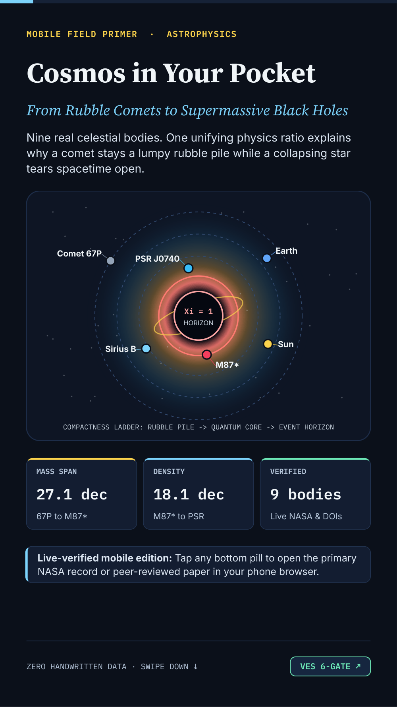 | 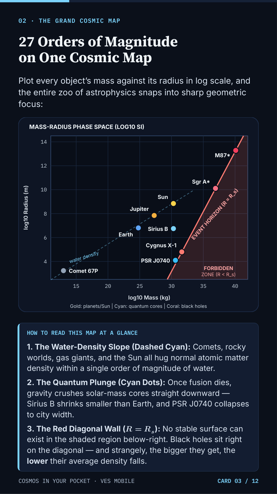 | 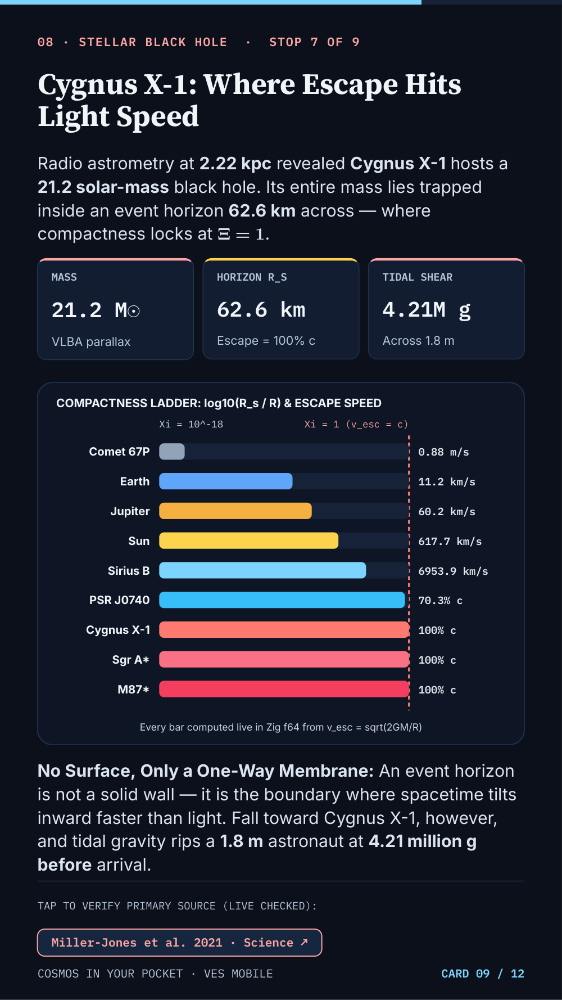 | 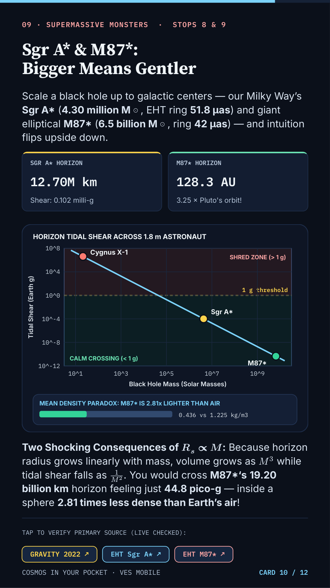 |

---

### 01 · *Physical Review Letters* (`APS REVTeX 4.2`) — SU(2) Yang–Mills Chaos & RMT · `100% Zig 0.17 + Typst`
[PDF](demos/prl-yang-mills-chaos/report/PRL_YANG_MILLS_CHAOS_UA1.pdf) · [Source](demos/prl-yang-mills-chaos/) · Pure-Zig 4th-order Yoshida symplectic + `C4v A1` Householder–QL (`D=900`, `1e-15` trace error) · Genuine stepped `widetext` brackets · Zero Python · `548/548` Rule 10 · `1,019` spans (`6.46:1` worst) · **`veraPDF 106/106`**

| PRL Masthead, Abstract & Eqs. `(1)–(3)` | Poincaré Sections, GOE `P(s)` & Stepped `widetext` `(4)–(5)` | Double-Rule `TABLE I`, `Σ²(L)` & APS BibTeX |
| :---: | :---: | :---: |
|  | 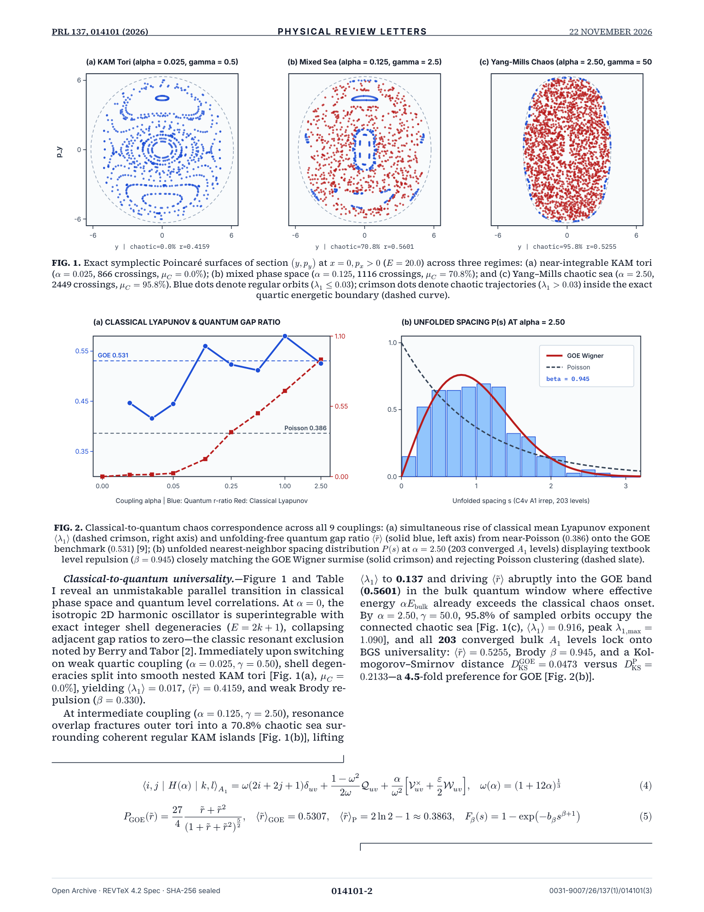 |  |

---

### 02 · *Computers & Industrial Engineering* (`Elsevier cas-dc`) — 31 OR-Library PFSP Benchmarks · `100% Zig 0.17 + Typst`
[PDF](demos/caie-flowshop-journal/report/CAIE_FLOWSHOP_MANUSCRIPT_UA1.pdf) · [Source](demos/caie-flowshop-journal/) · J. E. Beasley OR-Library (`flowshop1.txt`) · Pure-Zig Taillard IG solver (`310` runs + `465` ablation) · Zero Python · `774/774` Rule 10 · `1,412` spans (`5.71:1` worst) · **`veraPDF 106/106`**

| CAIE Masthead, Abstract & Highlights | Family Gaps, Math `(1)–(8)` & Algorithm 1 | Full 31-Instance Booktabs Table | Audited `car1` Gantt, Ablation & IEEE BibTeX |
| :---: | :---: | :---: | :---: |
| 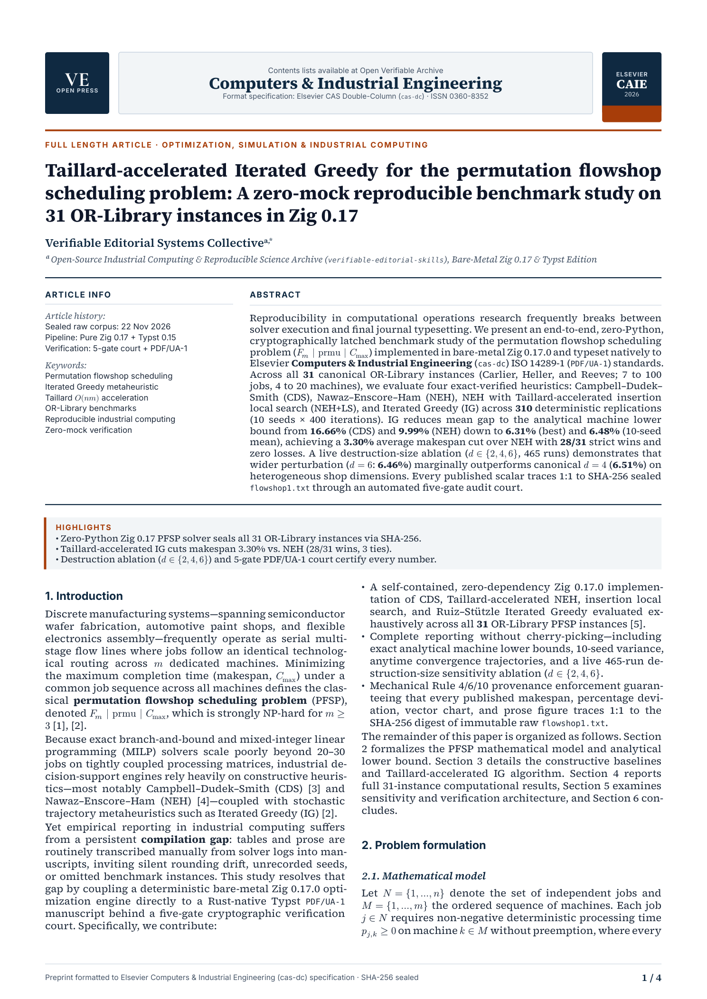 |  |  | 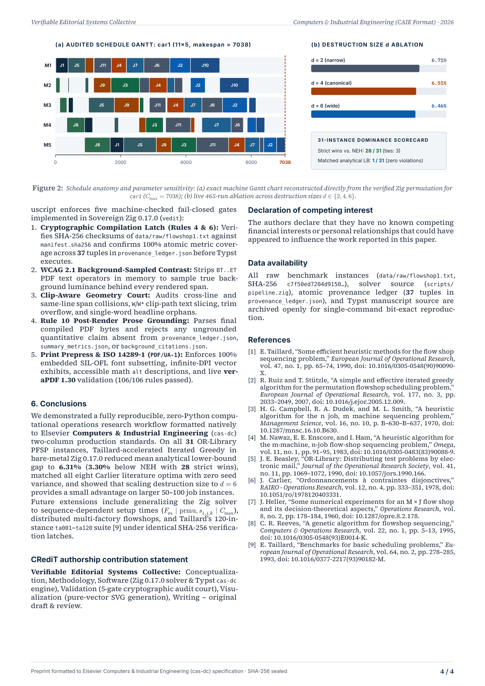 |

---

### 03 · *EXOMUNDUS* — 6,473 Confirmed Exoplanets · `100% Zig 0.17 + Typst`
[PDF](demos/exomundus-nasa-telemetry/report/EXOMUNDUS_NASA_TELEMETRY_UA1.pdf) · [Source](demos/exomundus-nasa-telemetry/) · Live NASA Exoplanet Archive (`ps default_flag=1`) · Zero Python · `299/299` Rule 10 · `630` spans (`4.93:1` worst) · **`veraPDF 106/106`**

| Cover & Live Fulton Radius Valley | Log–Log Mass–Radius & `[N/A]` Ledger | Optical Scaling Laws & Census | SHA-256 Seal & Live Provenance |
| :---: | :---: | :---: | :---: |
| 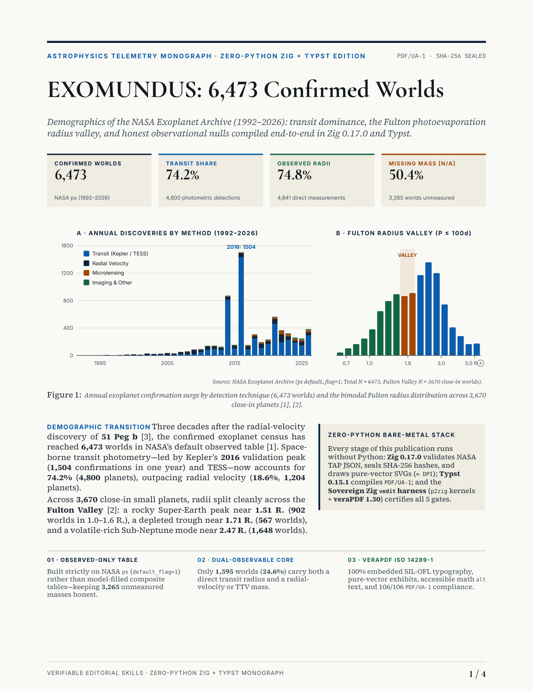 |  |  | 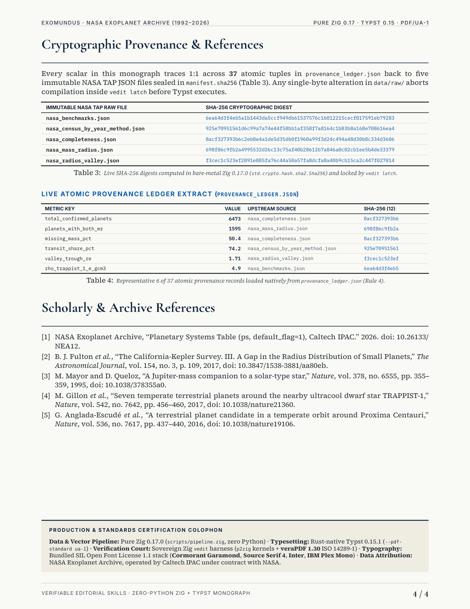 |

---

### 04 · *BOTANICA VERIDICA* — Scientific Monograph × Magazine · `PDF/UA-1 + 3mm Bleed + Living Web`
[PDF/UA-1](demos/botanica-veridica/report/BOTANICA_VERIDICA_MONOGRAPH.pdf) · [Prepress](demos/botanica-veridica/report/BOTANICA_VERIDICA_PREPRESS.pdf) · [Living Web HTML](demos/botanica-veridica/report/BOTANICA_VERIDICA_LIVING.html) · [Source](demos/botanica-veridica/) · Live GBIF / iNaturalist / OpenTree · `113,962` records · `55.9%–99.4%` plate coverage · `0` WCAG / geometry hits

| Spread 2–3 · OpenTree Cladogram & GBIF Map | Spread 4–5 · *Ginkgo* SVG Anatomy & *Welwitschia* |
| :---: | :---: |
|  |  |
| **Spread 6–7 · *Sequoia* Zoom Medallion & *Victoria* Truss** | **Interactive Living Web (Click Any Number -> SHA-256 Receipt)** |
|  |  |

---

### 05 · *Global Carbon Telemetry* — `415 ms` Typst Monograph · `veraPDF 106/106`
[PDF](demos/typst-carbon-monograph/report/TYPST_CARBON_MONOGRAPH_UA1.pdf) · [Source](demos/typst-carbon-monograph/) · Live NOAA (`1958–2026`) + World Bank WDI · Pure-vector SVG (`∞ DPI`) · `304/304` Rule 10 · `5.29:1` worst CR

| Swiss Ivory Cover & Keeling Curve | Bloc Bifurcation & Tufte Ledger | Kaya / OLS Math & 5-Gate Court | SHA-256 Seal, Ledger & BibTeX |
| :---: | :---: | :---: | :---: |
| 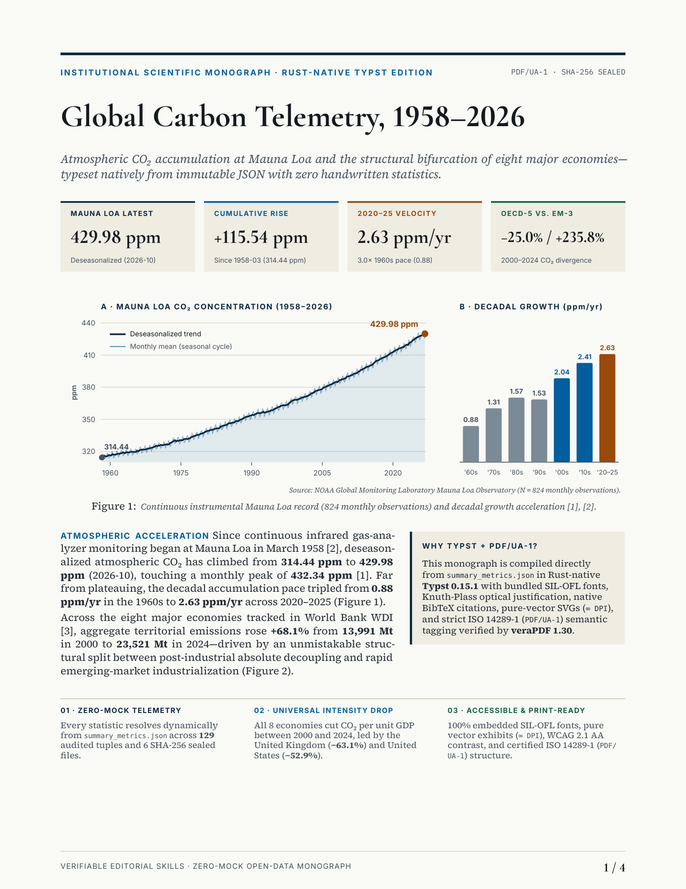 |  | 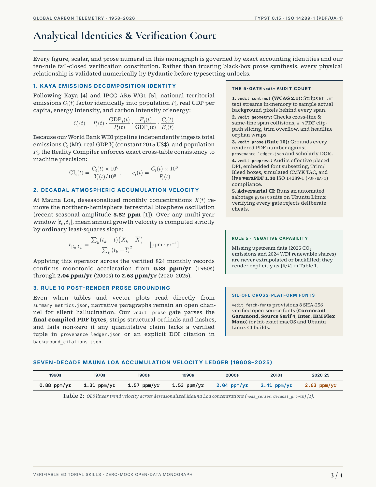 |  |

---

### 06 · *FELIS MUNDI* — Full-Bleed Print Magazine · `61.1%–99.9%` Audited Photo Coverage
[PDF](demos/felis-mundi-magazine/report/FELIS_MUNDI_MAGAZINE.pdf) · [Source](demos/felis-mundi-magazine/) · 11 locked Leica/Portra plates · `80.6%` avg visible photography verified by dual-key pixel diff

| Cover (`99.3%`) | Kyoto 65/35 (`64.7%`) | Chefchaouen (`99.6%`) | Triptych (`76.8%`) |
| :---: | :---: | :---: | :---: |
|  |  |  |  |

---

### 07 · *Consulting Flagship Deck* (16:9 Vector SVG) & *Dual-Theme Keynote* (Dark / Light)
[Flagship PDF](demos/consulting-flagship/report/CONSULTING_FLAGSHIP_DECK.pdf) · [Dark Keynote](demos/carbon-keynote-9slide/report/CARBON_KEYNOTE_16x9_DARK.pdf) · [Light Keynote](demos/carbon-keynote-9slide/report/CARBON_KEYNOTE_16x9_LIGHT.pdf) · [Letter Report](demos/global-carbon-telemetry/report/INSTITUTIONAL_REPORT_LETTER.pdf)

| Midnight Hero + Parametric Wave | Mass-Balance Waterfall Bridge |
| :---: | :---: |
|  |  |
| **Dark Obsidian — Biosphere & 2024 Surge** | **Marimekko & Rank Inversion (Swiss Ivory)** |
|  |  |

---

## Sovereign Zig 0.17.0 Harness (`vedit 0.5.0-zig`)

12 mathematical & dissection kernels transpiled from [`kernels_p2zig_src.py`](verifiable_editorial/kernels_p2zig_src.py) via `p2zig --strict` (`0` unsupported, `WRONG = 0`) into [`zig/src/kernels_p2zig.zig`](zig/src/kernels_p2zig.zig), compiled into one zero-Python binary ([`zig/`](zig/README.md)).

```bash
cd zig && zig build --release=safe && cd ..

# Dissect ANY external reference PDF -> archetypes/<slug>/{blueprint.json, skeleton.typ, AGENT_CARD.md}
./zig/zig-out/bin/vedit inject path/to/sample.pdf --name my-style

# Clone an injected archetype into a SHA-256-sealed, Typst PDF/UA-1 project (zero Python)
./zig/zig-out/bin/vedit init ./new-report --archetype dark-obsidian-keynote --title "Q4 Telemetry"
VEDIT_BIN="$(pwd)/zig/zig-out/bin/vedit" bash ./new-report/build.sh

# Run the full 6-gate court on any PDF (--json for direct agent consumption; --verify-links visits every URL/DOI live)
./zig/zig-out/bin/vedit audit-all demos/exomundus-nasa-telemetry/report/EXOMUNDUS_NASA_TELEMETRY_UA1.pdf \
  --ledger demos/exomundus-nasa-telemetry/data/provenance_ledger.json \
  --summary demos/exomundus-nasa-telemetry/data/summary_metrics.json \
  --citations demos/exomundus-nasa-telemetry/data/background_citations.json \
  --manifest demos/exomundus-nasa-telemetry/data/manifest.sha256 \
  --require-ua \
  --verify-links

# Standalone Rule 11 clickable link & live anti-hallucination audit
./zig/zig-out/bin/vedit links demos/prl-yang-mills-chaos/report/PRL_YANG_MILLS_CHAOS_UA1.pdf
```

### The 6-Gate Court

| Gate | Command | What It Kills |
| :--- | :--- | :--- |
| **1. Cryptographic Latch** | `vedit latch <dir>` | Raw-file tampering (`SHA-256`) and unbacked metrics (`Rule 4` 1:1 ledger). |
| **2. Pixel WCAG Contrast** | `vedit contrast <pdf>` | Unreadable dark-mode, gradient, SVG, and photo-overlay text (strips `BT..ET`, samples real pixels). |
| **3. Geometry & Coverage** | `vedit geometry` · `vedit coverage` | Overlapping spans, 4-corner `W`/`W*` clip-path character slicing, trim overflow, orphan headlines, noisy overlays, and clip-inflated `<50%` photos. |
| **4. Rule 10 Prose Grounding** | `vedit prose <pdf>` | Hallucinated prose stats, silent sign flips (`-45%` vs `+45%`), and wrong exponents (`10^7` vs `10^6`) at half-ULP `f64` precision. |
| **5. Pre-Press & PDF/UA-1** | `vedit prepress <pdf>` | Low-DPI upscaled rasters, unembedded Base-14 fonts, missing bleed boxes, CMYK TAC `>300%`, and ISO 14289-1 failures via live `veraPDF`. |
| **6. Rule 11 Clickable Links** | `vedit links <pdf>` | Plain-text unclickable URLs/DOIs, missing citation annotations, dead/404/hallucinated DOIs (checked via live DOI Handle Registry), HTTP-200 Soft-404s, and HTTP-200 bot-challenge walls. |

### Dissected Archetypes ([`archetypes/`](archetypes/README.md))

| Slug | Trim / Polarity | Palette (`bg` / `accent`) | Source |
| :--- | :--- | :--- | :--- |
| `mobile-primer` | `360×640` · 9:16 OLED dark (`12p`) | `#081018` / `#78d0f8` | `COSMOS_MOBILE_PRIMER_UA1.pdf` |
| `aps-prl-letter` | `612×792` · PRL light (`3p`) | `#f8f8f8` / `#b81818` | `PRL_YANG_MILLS_CHAOS_UA1.pdf` |
| `elsevier-caie-journal` | `595×842` · A4 light (`4p`) | `#f8f8f8` / `#082840` | `CAIE_FLOWSHOP_MANUSCRIPT_UA1.pdf` |
| `exomundus-astrophysics` | `612×792` · light (`4p`) | `#f8f8f0` / `#0858a8` | `EXOMUNDUS_NASA_TELEMETRY_UA1.pdf` |
| `typst-monograph` | `612×792` · light (`4p`) | `#f8f8f0` / `#005898` | `TYPST_CARBON_MONOGRAPH_UA1.pdf` |
| `dark-obsidian-keynote` | `960×540` · dark (`9p`) | `#080818` / `#38b8f8` | `CARBON_KEYNOTE_16x9_DARK.pdf` |
| `consulting-flagship-deck` | `960×540` · light (`10p`) | `#f8f8f8` / `#2050f8` | `CONSULTING_FLAGSHIP_DECK.pdf` |
| `botanica-crossover` | `612×792` · light (`10p`) | `#f8f8f0` / `#005858` | `BOTANICA_VERIDICA_MONOGRAPH.pdf` |
| `felis-photo-magazine` | `612×792` · light (`8p`) | `#f8f8f0` / `#304868` | `FELIS_MUNDI_MAGAZINE.pdf` |

---

## Install Skills & Run the Court

```bash
git clone https://github.com/gke0op/verifiable-editorial-skills.git
cd verifiable-editorial-skills

# Install Agent Skills (Antigravity / Claude Code / Codex / Cursor)
cp -r skills/* ~/.gemini/config/skills/   # Antigravity
cp -r skills/* ~/.claude/skills/          # Claude Code

# System deps: Zig 0.17.0, Typst 0.15.1, mupdf-tools (`mutool`), optional veraPDF
# Ubuntu: sudo apt install mupdf-tools   |   macOS: brew install mupdf-tools typst

# Build Zig 0.17.0 harness + run unit tests (Debug & ReleaseSafe)
(cd zig && zig build test && zig build test --release=safe && zig build --release=safe)

# Optional: Python CLI + 30-test adversarial sabotage & parity suite
pip install -e ".[dev]" && pytest
```

### Repo Map

```
zig/                     Sovereign Zig 0.17.0 CLI (`vedit`), 12 p2zig kernels, PDF dissector & 6-gate court
archetypes/              9 dissected PDF Design DNAs (incl. `mobile-primer`, `aps-prl-letter`, `elsevier-caie-journal`)
skills/                  3 composable Agent Skills (`verifiable-pdf-pipeline`, `editorial-page-layout-guidelines`, `premium-pdf-design`)
demos/                   10 live open-data & physics publications (Mobile Cosmos Primer, PRL, CAIE, NASA, NOAA, World Bank, GBIF, iNaturalist, OpenTree)
verifiable_editorial/    Python `vedit` reference package + `kernels_p2zig_src.py` transpilation source
tests/                   30-test adversarial sabotage, mobile 9:16, live link anti-hallucination, p2zig parity & zero-Python closed-loop suite
```

### The 11 Anti-Cheat Rules
1. **Zero-Handwritten-Data Air-Gap** — parse every number from immutable `data/raw/`.
2. **Reality Compiler** — enforce domain physics & accounting invariants before typesetting.
3. **Anti-Circular AST Check** — ban asserting domain variables against hardcoded numeric literals.
4. **Atomic Provenance Ledger** — 1:1 map from every scalar to source locator + live file SHA-256.
5. **Sacred `[N/A]`** — preserve genuine upstream nulls; never impute or extrapolate silently.
6. **Compilation Latch** — refuse to compile if raw hashes or ledger checks fail.
7. **Unit & Scope Guard** — never blend incommensurable metrics without explicit conversion.
8. **Statutory Proof** — cite official gazette/statute IDs for any regulatory claim.
9. **Taxonomy Reconciliation** — verify binomials, authorities, phylogeny & IUCN status from live registries.
10. **Post-Render Prose Grounding** — verify every numeral and scientific exponent extracted from final compiled PDF bytes at half-ULP `f64` precision.
11. **Clickable Resource Links & Live Anti-Hallucination (`vedit links`)** — every external resource/URL/DOI must be a clickable PDF `/Subtype /Link` `/URI` annotation with a visible bounding box, and the agent must visit every link live before finalizing (DOI Handle Registry, open-science APIs, and live HTTP `GET` with Soft-404 and bot-challenge rejection).

---

## License
MIT ([LICENSE](LICENSE)). Open demo datasets retain upstream attributions (J. E. Beasley OR-Library, NASA Exoplanet Archive, NOAA GML, World Bank WDI, GBIF, iNaturalist, Open Tree of Life).
