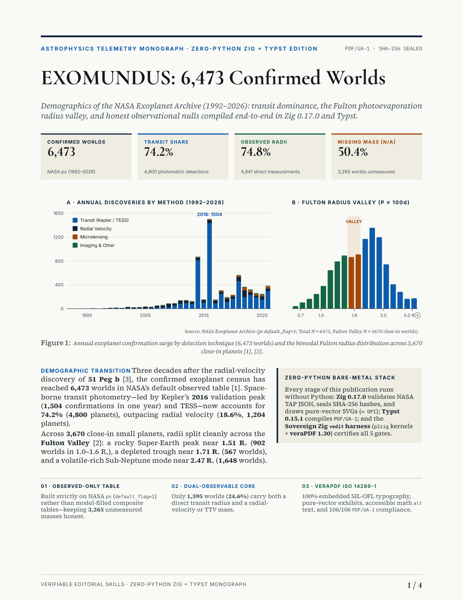
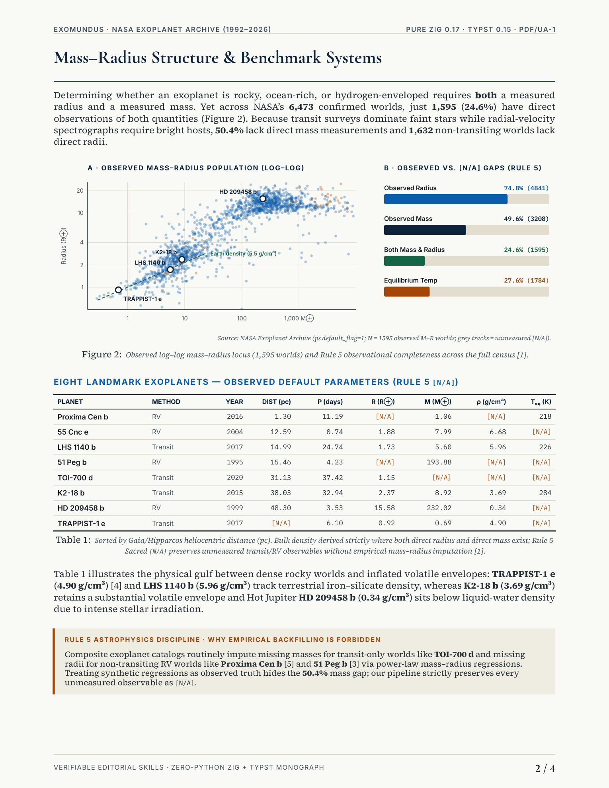
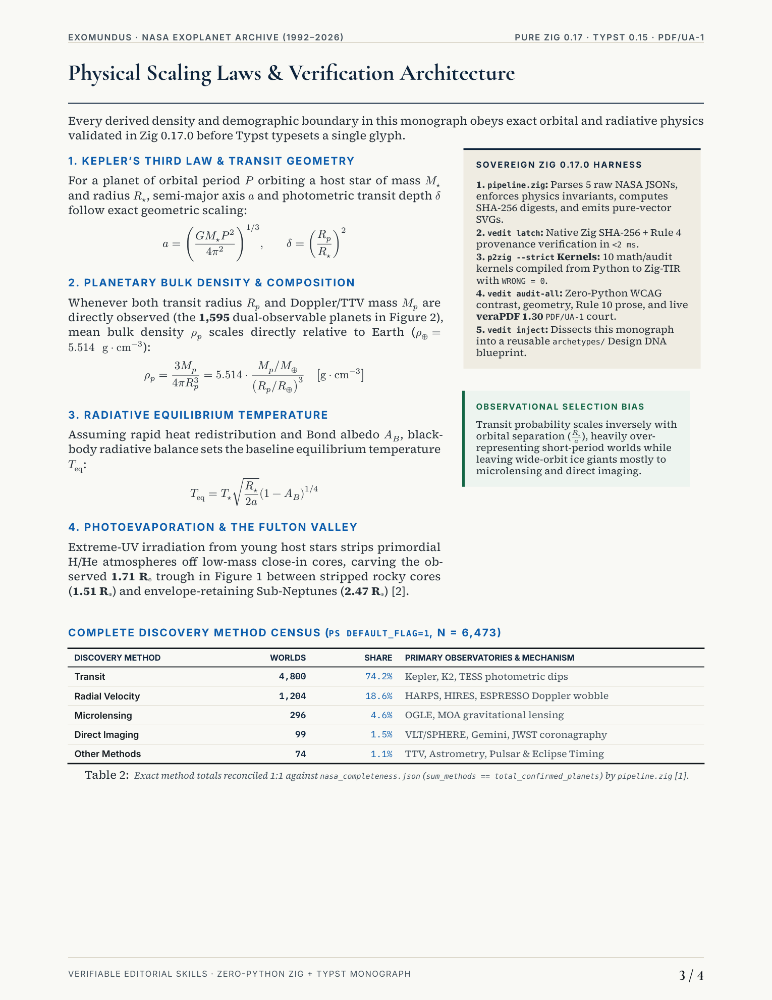
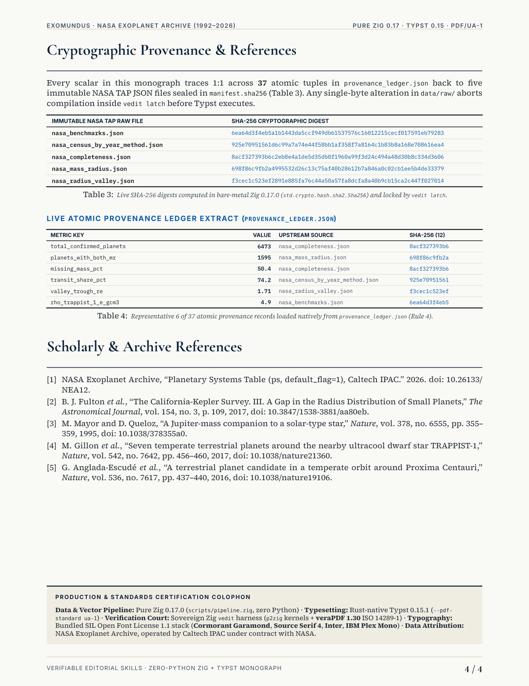

# EXOMUNDUS: Census of 6,473 Confirmed Exoplanets (1992–2026) — 100% Zero-Python Zig 0.17.0 + Typst `PDF/UA-1` Monograph

A 4-page astrophysics monograph demonstrating a **100% zero-Python bare-metal publishing pipeline** from live open scientific telemetry to **ISO 14289-1 (`PDF/UA-1`)** certification:

- **Live Zero-Auth Scientific Telemetry:** Streams 5 immutable JSON tables from the **NASA Exoplanet Archive (Caltech IPAC) TAP API** (`ps where default_flag=1`, `6,473` confirmed exoplanets across `1992–2026`) — strictly using NASA's observed-only default parameter set so `3,265` unmeasured masses (`50.4%`) and `1,632` unmeasured radii remain authentic Rule 5 `[N/A]` gaps rather than empirical mass–radius regressions.
- **Pure-Zig 0.17.0 Reality Compiler, SHA-256 Sealer & Vector SVG Engine ([`scripts/pipeline.zig`](scripts/pipeline.zig)):** Validates astrophysical domain invariants, reconciles cross-table census totals, seals `data/manifest.sha256` via `std.crypto.hash.sha2.Sha256`, emits `37` atomic Rule 4 tuples into `data/provenance_ledger.json`, and draws two pure-vector SVG exhibits (`∞ DPI`: Annual Discovery Cadence + Live Fulton Radius Valley, and Log–Log Mass–Radius Population of `1,595` observed worlds + Rule 5 completeness bars).
- **Pure-Zig Rule 6 Compilation Latch (`vedit latch`):** Cryptographically verifies `5/5` raw files and `37/37` provenance tuples before Typst runs.
- **Rust-Native Typst 0.15.1 (`--pdf-standard ua-1`):** Optical astrophysics equations (`Kepler III`, `Transit Depth`, `Bulk Density`, `Radiative Equilibrium`) with accessible ISO 14289-1 `alt` text, native IEEE BibTeX, and bundled SIL-OFL fonts.
- **Sovereign Zig 0.17.0 5-Gate Court (`vedit audit-all --require-ua`):** Passes WCAG 2.1 AA contrast (`630` spans, worst `4.93:1`, `0` violations), geometry (`0/0/0/0`), Rule 10 prose grounding (`299/299` verified, `0` ungrounded), and print pre-press + live **`veraPDF` ISO 14289-1 (`106` passed rules, `0` failed)**.

---

## Page Previews

| Page 1 — Cover, KPIs & Fulton Radius Valley | Page 2 — Log–Log Mass–Radius & Benchmark Ledger |
| :---: | :---: |
|  |  |

| Page 3 — Scaling Laws & Discovery Method Census | Page 4 — SHA-256 Seal, Live Provenance & BibTeX |
| :---: | :---: |
|  |  |

---

## Reproduce Locally (Zero Python Required)

```bash
# Prerequisites: zig 0.17.0, typst 0.15.1, mupdf-tools (mutool), optional verapdf
cd zig && zig build --release=safe && cd ..
bash demos/exomundus-nasa-telemetry/run_pipeline.sh
```
