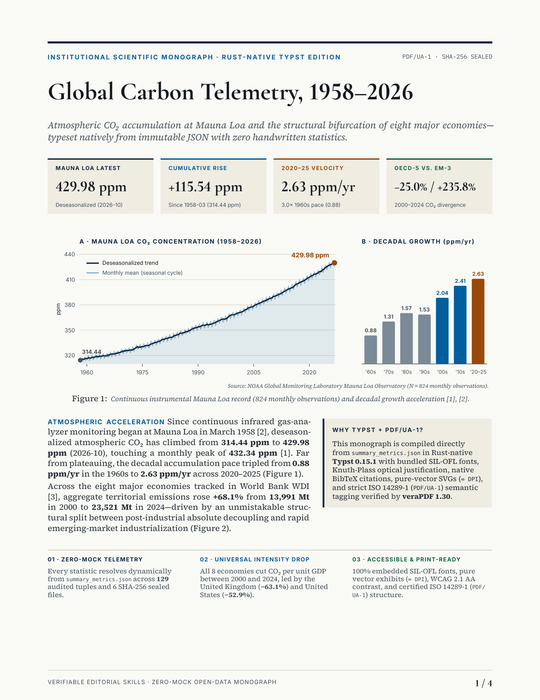
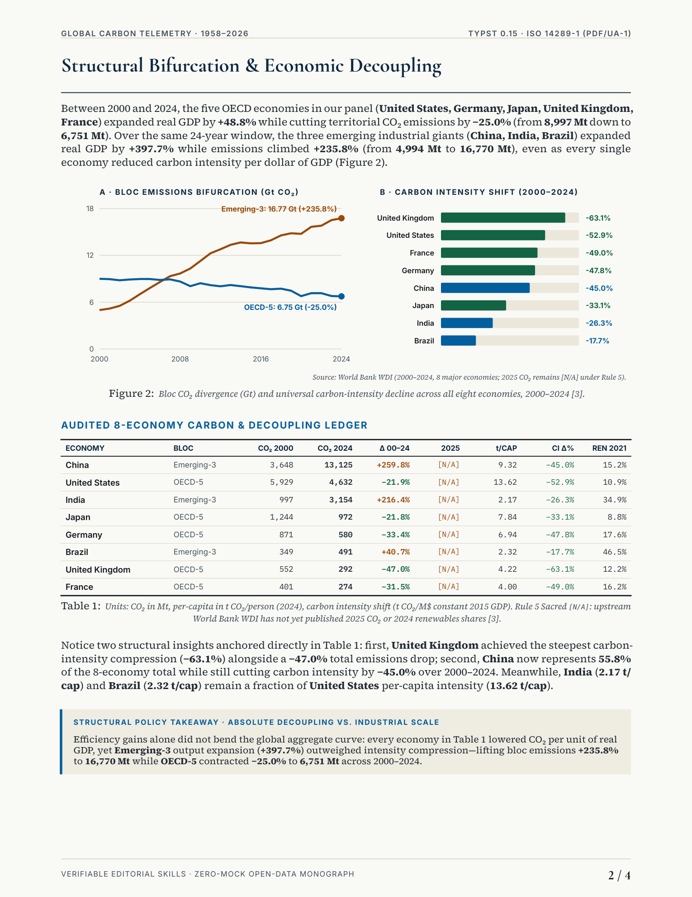
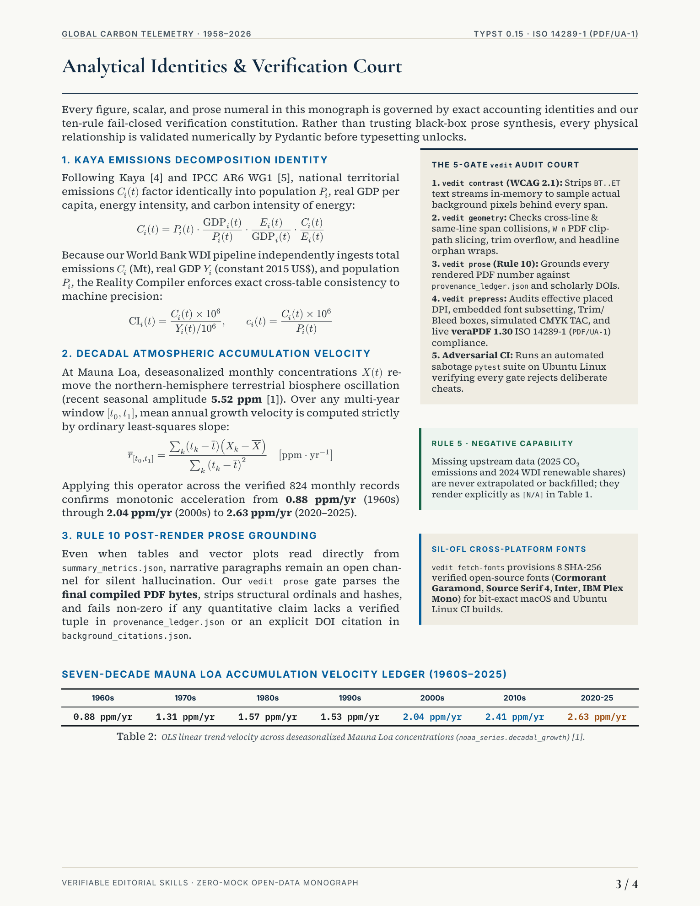
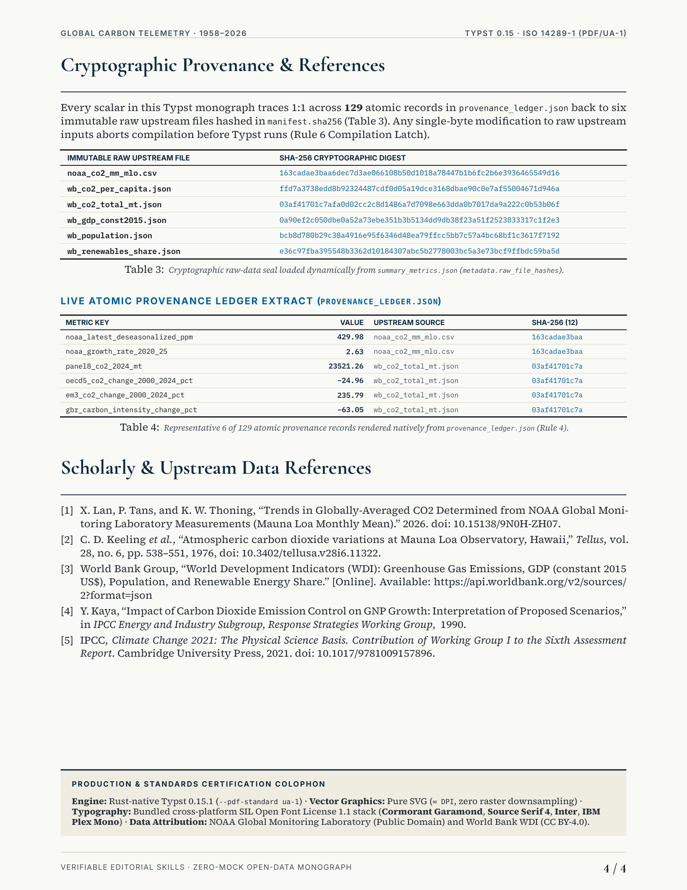

# Global Carbon Telemetry (1958–2026) — Rust-Native Typst `PDF/UA-1` Monograph

A 4-page publication-grade scientific monograph demonstrating **SOTA Pillars #4 & #5**:

- **Sub-Second Rust-Native Compilation (`~415 ms`):** Compiles directly from immutable upstream JSON (`#let data = json("../../global-carbon-telemetry/data/summary_metrics.json")` and `provenance_ledger.json`) in **Typst 0.15.1** with zero Python HTML/string templating.
- **Cross-Platform SIL-OFL Open-Source Fonts (`vedit fetch-fonts`):** Provisions 8 SHA-256 verified fonts (*Cormorant Garamond*, *Source Serif 4*, *Inter*, *IBM Plex Mono*) for bit-exact identical output on macOS and Ubuntu Linux CI.
- **100% Certified ISO 14289-1 (`PDF/UA-1`):** Verified by live **`veraPDF 1.30`** (`106` passed rules, `0` failed rules) with semantic tag trees, document language/title metadata, and screen-reader `alt` text on every vector exhibit and optical display math equation.
- **Pure-Vector Exhibits (`∞ DPI`):** Dual-panel Keeling Curve + Decadal Acceleration and Bloc Divergence + Carbon Intensity Shift rendered directly as pure-vector SVG — zero raster downsampling and `0` unembedded fonts.
- **6-Gate Automated Court (`vedit audit-all`):** Passes WCAG 2.1 AA background-sampled contrast (`520 spans`, worst `5.29:1`, `0` violations), geometric collision/clipping/orphan linting (`0/0/0/0/0`), Rule 10 post-render PDF prose grounding (`304/304` tokens verified, `0` ungrounded), print pre-press (`cmyk_p99_tac=119.4% <= 300%`, `unembedded_fonts=0`, `verapdf=compliant`), and Rule 11 clickable link verification.

---

## Page Previews

| Page 1 — Swiss Ivory Cover & Vector Keeling Curve | Page 2 — Bloc Bifurcation & Tufte 8-Economy Ledger |
| :---: | :---: |
|  |  |

| Page 3 — Optical Kaya/OLS Math & 6-Gate Court | Page 4 — SHA-256 Seal, Live Provenance & IEEE BibTeX |
| :---: | :---: |
|  |  |

---

## Reproduce Locally (Zero Python · macOS / Linux)

```bash
# Prerequisites: Zig 0.17.0, Typst 0.15.1, mupdf-tools (`mutool`), optional veraPDF
bash demos/typst-carbon-monograph/run_pipeline.sh
```

The script automatically executes:
1. Pure-Zig Rule 4 + Rule 6 Compilation Latch (`vedit latch`) against the 6 SHA-256 sealed NOAA & World Bank raw files.
2. `vedit fetch-fonts` to verify/download the 8 cross-platform SHA-256-pinned SIL-OFL TTF files.
3. Pure-Zig 0.17.0 `scripts/pipeline.zig` to emit pure-vector SVGs (`∞ DPI`) straight from `summary_metrics.json`.
4. Timed `typst compile --pdf-standard ua-1` (`~415 ms`).
5. `vedit audit-all --min-dpi 300 --require-ua` (WCAG contrast, geometry, Rule 10 prose grounding, pre-press + live `veraPDF` certification, and Rule 11 link integrity).
